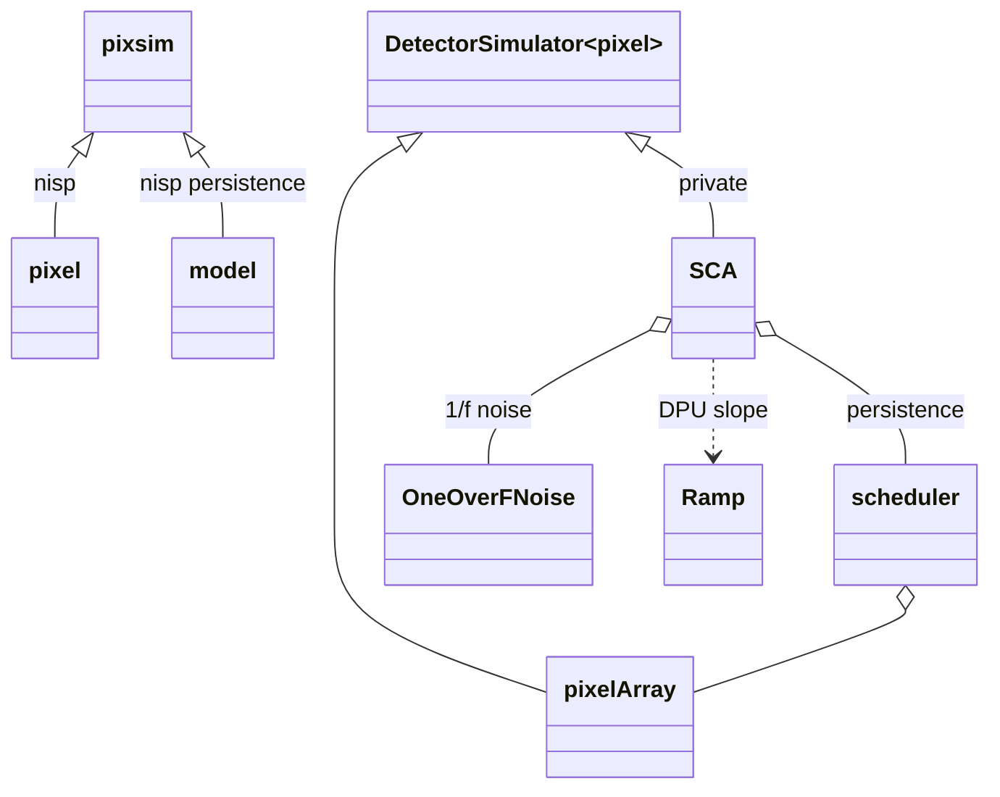
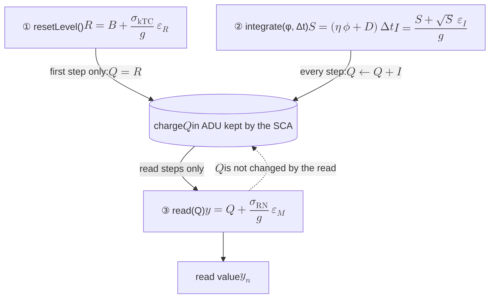

# NISP example: the Euclid HAWAII-2RG detectors

`src/nisp/` is a complete instrument built on the phot2pix core: a simulator of the infrared detectors of Euclid's **NISP** (Near-Infrared Spectrometer and Photometer). It shows how an instrument is assembled from the generic building blocks described in [Philosophy](Philosophy).

---

## 1. The instrument in a few lines

- NISP has 16 **Teledyne HAWAII-2RG** (H2RG) HgCdTe arrays. Each SCA (sensor chip assembly) is 2048 × 2048 pixels of 18 µm, including a 4-pixel border of reference pixels (2040 × 2040 sensitive).
- An SCA is read **non-destructively**, one full frame every **1.45408 s**, through **32 output channels** of 64 columns each.
- Reads are taken in **MACC(ng, nr, nd)** mode: *ng* groups of *nr* consecutive reads, separated by *nd* frames that are read but dropped.
  - Photometry uses MACC(4,16,4) (87.2 s between the first and last group).
  - Spectroscopy uses MACC(15,16,11) (549.6 s).
- The onboard **DPU** averages each group and fits a slope to the group averages (Kubik et al. 2016, PASP 128, 104504). Only that slope image is sent to the ground.

---

## 2. Map of the code

| File | Content |
|---|---|
| `nispPixel.h/.cxx` | `nisp::pixel`: the H2RG pixel. `nisp::Ramp`: the DPU slope estimator (group co-adding, Kubik slope, Fowler, CDS) |
| `nispSCA.h/.cxx` | `nisp::SCA`: the detector and its readout modes. `nisp::macc`: MACC parameters. `nisp::persistence`: the persistence model (`model`, `pixelArray`, `scheduler`) |
| `nispOneOverFNoise.h/.cxx` | `nisp::OneOverFNoise`: correlated 1/f noise of the output channels |
| `../utilities/nispSimulator.cxx` | Command-line tool driven by a JSON file |
| `../utilities/*.json` | A default configuration with averaged NISP values, and one test configuration per readout mode |



How the layers map onto the [philosophy](Philosophy):

- **Pixel:** `nisp::pixel` uses the three `pixsim` stages unchanged (reset level, integration, read). NISP-specific pixel physics would go there, by overriding a stage.
- **Detector:** `nisp::SCA` inherits `DetectorSimulator<nisp::pixel>` **privately**. Its simulation engines produce **charge only** (`resetLevel() + integrate()`), never a complete read.
- **Instrument:** `nisp::SCA` sequences the reads of each readout mode, adds the read noise (through `pixel::read()`) and the 1/f noise at each read, and runs the DPU processing. Its only public simulation entry point is `expose()`.

---

## 3. The model in equations

This section writes down what the code computes. Every ε is an independent draw from a standard normal N(0, 1): draws are independent between pixels, between stages and between reads.

### 3.1 One pixel

| Symbol | Meaning | Unit | Config key |
|---|---|---|---|
| $`\phi`$ | Incident flux | ph s⁻¹ | input array |
| $`\eta`$ | Quantum efficiency | — | `QE` |
| $`D`$ | Dark current | e⁻ s⁻¹ | `dark` |
| $`g`$ | Gain | e⁻ ADU⁻¹ | `gain` |
| $`B`$ | Baseline | ADU | `baseline` |
| $`\sigma_{\mathrm{kTC}}`$ | Reset (kTC) noise | e⁻ | `KTCnoise` |
| $`\sigma_{\mathrm{RN}}`$ | Read noise | e⁻ | `readNoise` |
| $`t_f`$ | Frame time | s | `frame_time` |

**The three stages** (`phot2pix::pixsim`, used unchanged by `nisp::pixel`). Every stage returns ADU:

```math
\begin{aligned}
\text{reset:}\quad & R = B + \frac{\sigma_{\mathrm{kTC}}}{g}\,\varepsilon_R && \texttt{resetLevel()}\\[6pt]
\text{integration over } \Delta t\text{:}\quad & I(\Delta t) = \frac{S + \sqrt{S}\,\varepsilon_I}{g}, \qquad S = (\eta\,\phi + D)\,\Delta t && \texttt{integrate}(\phi, \Delta t)\\[6pt]
\text{read of a charge } Q\text{:}\quad & M(Q) = Q + \frac{\sigma_{\mathrm{RN}}}{g}\,\varepsilon_M && \texttt{read}(Q)
\end{aligned}
```

*S* is the mean number of electrons collected. Its shot noise √S is the Gaussian approximation of Poisson, and I(Δt) = 0 when S = 0.

**A single read** (`pixelresponse()`, the FLUX mode) chains the three stages:

```math
y = M\big(R + I(T)\big) = B + \frac{S + \sqrt{S}\,\varepsilon_I + \sigma_{\mathrm{kTC}}\,\varepsilon_R + \sigma_{\mathrm{RN}}\,\varepsilon_M}{g},
\qquad
\langle y\rangle = B + \frac{S}{g},
\qquad
\mathrm{Var}(y) = \frac{S + \sigma_{\mathrm{kTC}}^2 + \sigma_{\mathrm{RN}}^2}{g^2}
```

**A ramp** reads the pixel once per frame without resetting it. With $`S_f = (\eta\,\phi + D)\,t_f`$ the mean charge collected in one frame, the charge after frame *n* and the value of read *n* are

```math
Q_1 = R + I_1, \qquad Q_n = Q_{n-1} + I_n, \qquad y_n = M(Q_n) = Q_n + \frac{\sigma_{\mathrm{RN}}}{g}\,\varepsilon_n
```

where each $`I_n`$ is an independent draw of $`I(t_f)`$. The charge carries the memory of the ramp and the read noise does not. The statistics of the ramp follow:

```math
\langle y_n\rangle = B + n\,\frac{S_f}{g},
\qquad
\mathrm{Cov}(y_m, y_n) = \frac{\sigma_{\mathrm{kTC}}^2 + \min(m,n)\,S_f + \delta_{mn}\,\sigma_{\mathrm{RN}}^2}{g^2}
```

so that

```math
\mathrm{Var}(y_n) = \frac{\sigma_{\mathrm{kTC}}^2 + n\,S_f + \sigma_{\mathrm{RN}}^2}{g^2},
\qquad
\mathrm{Var}(y_{n+1} - y_n) = \frac{S_f + 2\,\sigma_{\mathrm{RN}}^2}{g^2},
\qquad
\mathrm{Var}(y_N - y_1) = \frac{(N-1)\,S_f + 2\,\sigma_{\mathrm{RN}}^2}{g^2}
```

The last relation is the CDS: the reset level *R* and its kTC noise cancel. These relations are the ones checked by `gTest_nispSCA.cxx` ([§8](#8-validation)).

### 3.2 The full array

Pixel *i* sits at column *x* and row *y*, with i = y·W + x (W × H = 2048 × 2048). Every parameter of §3.1 can be a per-pixel FITS map: $`\eta_i, D_i, g_i, B_i, \sigma_{\mathrm{kTC},i}, \sigma_{\mathrm{RN},i}`$. Pixels remain independent, except through two terms that the SCA adds on top of the pixel model:

- the **1/f noise** $`\mathcal{N}`$, shared by all the pixels of one output channel and added at each read;
- the **persistence** *P*, which depends on the previous exposures and is added to the charge.

A quantiser then converts each value to `uint16`:

```math
\mathcal{Q}(x) = \min\big(65535,\ \max(0,\ \lfloor x + \tfrac{1}{2} \rfloor)\big),
\qquad
\mathcal{Q}_{so}(x) = \mathcal{Q}(s\,x + o)
```

with *s* = `scale` and *o* = `offset`.

#### Steps of a ramp

An exposure is simulated as a sequence of charge steps m = 1 … M of duration Δt_m. In MACC(n_g, n_r, n_d), each group contributes n_r steps of t_f, each followed by a read. Between two groups there is one step of n_d·t_f with no read (the dropped frames). Read *r* of group *g* is stored in layer ℓ = g·n_r + r and taken at frame

```math
n_\ell = g\,(n_r + n_d) + r + 1
```

that is, n_ℓ·t_f after the reset. UTR is MACC(N, 1, 0).

#### Charge

```math
Q_i[m] = R_i + \sum_{m'=1}^{m} \Big( I_i(\Delta t_{m'}) + P_i[m'] \Big)
```

$`R_i`$ is drawn at the first step only; the later steps are run with `baseline = "off"`.

#### MACC and UTR: one layer of the output cube

```math
Y_i[\ell] = \mathcal{Q}\Big( Q_i[m_\ell] + \frac{\sigma_{\mathrm{RN},i}}{g_i}\,\varepsilon_{i,\ell} + \mathcal{N}_{c(i)}\big[(n_\ell - 1)\,L_c + u_i\big] \Big)
```

where $`m_\ell`$ is the step that ends at frame $`n_\ell`$. MACC and UTR layers are rounded and clamped but **not** scaled or offset.

#### 1/f noise of channel *c*

Channel *c* covers the columns $`[x_c,\ x_c + w_c)`$: w_c = 64 by default, and 60 for the two edge channels of a 2040-wide frame. During one frame its amplifier reads L_c = H·w_c pixels, row by row, and pixel *i* is sample $`u_i = y\,w_c + (x - x_c)`$. The noise of the channel is a single time series over the whole ramp, a sum of n_p AR(1) processes:

```math
\mathcal{N}_c[t] = A \sum_{p=0}^{n_p-1} z_{c,p}[t],
\qquad
z_{c,p}[t] = \rho_p\, z_{c,p}[t-1] + \sigma_p\,\varepsilon_{c,p,t},
\qquad
z_{c,p}[-1] = 0
```

```math
\nu_p = \nu_{\min} \left(\frac{0.5}{\nu_{\min}}\right)^{p/(n_p-1)},
\quad
\nu_{\min} = \frac{1}{2 L_c},
\qquad
\rho_p = e^{-2\pi\nu_p},
\qquad
\sigma_p \propto \nu_p^{(1-a)/2},
\quad
\sum_p \frac{\sigma_p^2}{1 - \rho_p^2} = 1
```

The corner frequencies ν_p are in cycles per sample and log-spaced (ν_0 = ν_min when n_p = 1). *A* is `amplitude` and *a* is `slope`. The normalisation gives a stationary variance A², and together the poles approximate a spectrum ∝ 1/ν^a. Every frame, read or dropped, consumes L_c consecutive samples, so t = (n_ℓ − 1)·L_c + u_i is the time at which the amplifier reads pixel *i* in read ℓ.

#### Persistence

Each past exposure *j* leaves a stored charge $`E_i^{(j)} = \eta_i\,\phi_i^{(j)}\,T^{(j)}`$, in electrons, where $`T^{(j)}`$ is the integration time registered for that exposure (see [§9](#9-known-limitations) for MACC). For traps $`(f_k, \tau_k)`$, and with $`\Delta_j[m]`$ the time between the end of exposure *j* and the start of step *m*:

```math
P_i[m] = \sum_j E_i^{(j)} \sum_k f_k\, e^{-\Delta_j[m]/\tau_k}\, \tau_k \left( e^{\Delta t_m/\tau_k} - 1 \right)
```

Exposures are simulated back to back, so $`\Delta_j[m]`$ counts only simulated steps. $`P_i[m]`$ is added to the charge as it is, without conversion by $`g_i`$.

#### FLUX and CDS

Both modes read the array once or twice. Each read draws a new 1/f realisation that starts from a zero state ($`\mathcal{N}`$ and $`\mathcal{N}'`$ below, with t = u_i).

```math
\text{FLUX:}\qquad Y_i = \mathcal{Q}_{so}\Big( M_i\big(R_i + I_i(T') + P_i[1]\big) + \mathcal{N}_{c(i)}[u_i] \Big),
\qquad T' = \lfloor T/t_f \rfloor\, t_f
```

```math
\text{CDS:}\qquad
\begin{aligned}
Q_i^{(1)} &= R_i + I_i(t_f) + P_i[1], \qquad
Q_i^{(N)} = Q_i^{(1)} + I_i\big((N-1)\,t_f\big) + P_i[2], \qquad N = \lfloor T/t_f \rfloor\\[4pt]
Y_i &= \mathcal{Q}_{so}\Big( \big[M_i(Q_i^{(N)}) + \mathcal{N}'_{c(i)}[u_i]\big] - \big[M_i(Q_i^{(1)}) + \mathcal{N}_{c(i)}[u_i]\big] \Big)
\end{aligned}
```

$`M_i`$ is the read of §3.1 with the parameters of pixel *i*. Each call draws a new ε. The windowed single read `expose(flux, t, c0, r0, nc, nr)` uses the FLUX expression on the window, with *T* not rounded to whole frames.

#### DPU: the onboard slope, per pixel

The DPU starts from the MACC layers $`Y_i[\ell]`$. Let $`n_{\mathrm{good}}`$ be the number of groups before the first group that contains a saturated read (65535). Then

```math
G_g = \frac{1}{n_r} \sum_{r=0}^{n_r-1} Y_i[g\,n_r + r],
\qquad
d_g = G_{g+1} - G_g,
\qquad
g < n_{\mathrm{good}}
```

and the Kubik et al. (2016) estimator, with $`\sigma_{\mathrm{DPU}}`$ = `dpu_noise` and $`g_{\mathrm{DPU}}`$ = `dpu_gain`, is

```math
\alpha = \frac{1 - n_r^2}{3\,n_r\,(n_r + n_d)},
\qquad
\sigma = \frac{\sigma_{\mathrm{DPU}}}{g_{\mathrm{DPU}}},
\qquad
\beta = \frac{2\,\sigma^2}{g_{\mathrm{DPU}}\, n_r\,(1 + \alpha)},
\qquad
\gamma = \frac{2}{g_{\mathrm{DPU}}\,(1 + \alpha)}
```

```math
\bar F = \frac{1}{n_{\mathrm{good}} - 1} \sum_{g=0}^{n_{\mathrm{good}}-2} (d_g + \beta)^2,
\qquad
\hat F = \frac{\sqrt{1 + \gamma^2 \bar F} - 1}{\gamma} - \beta,
\qquad
Y_i =
\begin{cases}
\mathcal{Q}_{so}(\hat F) & n_{\mathrm{good}} \ge 2\\
65535 & \text{otherwise}
\end{cases}
```

$`\hat F`$ is in ADU per group interval. For an unsaturated pixel, $`\langle d_g \rangle = (n_r + n_d)\,S_{f,i}/g_i`$.

### 3.3 The algorithm

#### One pixel

The pixel provides three stages and holds no state. The charge *Q* is kept by the caller, the SCA readout loop, which decides when to reset, how long each step lasts and when to read.

<!-- Diagram labels use Mermaid's KaTeX syntax $$…$$ (Mermaid ≥ 10.9). -->



- **Single read (FLUX):** reset, one step of *T*, one read.
- **Ramp (MACC, UTR):** reset, then one step per frame, with a read after each frame that is not dropped. The n_d dropped frames are a single step of n_d·t_f.

#### Full array: one exposure

`nisp::SCA::expose()` dispatches on `exposureMode`. In the ramp loop, each step runs three tasks concurrently and then makes one threaded pass over memory.

```mermaid
flowchart TD
    START["expose(flux, macc) or expose(flux, T)"] --> MODE{"exposureMode"}

    MODE -->|"FLUX"| FL["one charge step over $$T'$$, + persistence<br/>one read: $$M_i(Q_i) + \mathcal{N}_{c(i)}$$<br/>output $$\mathcal{Q}_{so}$$, $$W \times H$$"]
    MODE -->|"CDS"| CD["charge at read 1, then at read N, + persistence<br/>two independent reads, difference<br/>output $$\mathcal{Q}_{so}$$, $$W \times H$$"]
    MODE -->|"MACC, UTR, DPU"| INIT["$$\mathrm{cumul}_i = 0$$ in ADU<br/>open the 1/f stream: one AR(1) state per channel<br/>allocate the uint16 cube $$W \times H \times n_g n_r$$"]

    INIT --> STEP

    subgraph STEP ["Read step: frame n_ℓ, Δt = t_f"]
        direction TB
        subgraph PAR ["Concurrent tasks"]
            direction LR
            A1["1/f noise<br/>stream.next(), one task per channel<br/>$$\mathcal{N}_c[t]$$"]
            A2["pixel charge<br/>DetectorSimulator::simulate<br/>$$R_i\ (\text{first step only}) + I_i(t_f)$$<br/>pixel ranges split over threads"]
            A3["persistence scheduler<br/>$$P_i[m]$$ over the past exposures $$j$$<br/>other half of the threads"]
        end
        SUM["$$\mathrm{frame}_i = \mathrm{charge}_i + P_i[m]$$"]
        ACC["_accumulate, threaded<br/>$$\mathrm{cumul}_i \leftarrow \mathrm{cumul}_i + \mathrm{frame}_i$$<br/>$$Y_i[\ell] = \mathcal{Q}\big(M_i(\mathrm{cumul}_i) + \mathcal{N}_{c(i)}\big)$$"]
        PAR --> SUM --> ACC
    end

    ACC --> LASTR{"last read<br/>of the group?"}
    LASTR -->|"no"| STEP
    LASTR -->|"yes"| LASTG{"last group?"}
    LASTG -->|"no"| DROP["dropped frames, if $$n_d \ge 1$$<br/>one charge step of $$n_d\,t_f$$, + persistence<br/>skip $$n_d$$ chunks of the 1/f stream<br/>$$\mathrm{cumul}_i \leftarrow \mathrm{cumul}_i + \mathrm{frame}_i$$, no layer written"]
    DROP --> STEP
    LASTG -->|"yes"| REG["store the charge map $$E_i = \eta_i\,\phi_i\,T$$<br/>in the persistence history"]

    REG --> DPUQ{"DPU?"}
    DPUQ -->|"no: MACC, UTR"| CUBE["uint16 cube<br/>$$W \times H \times n_g n_r$$"]
    DPUQ -->|"yes"| DPU["per pixel, threaded<br/>cut at the first saturated group: $$n_{\mathrm{good}}$$<br/>co-add the groups $$G_g$$<br/>Kubik slope $$\hat F$$<br/>output $$\mathcal{Q}_{so}(\hat F)$$"]
    DPU --> MAP["uint16 slope map<br/>$$W \times H$$"]
```

Two invariants hold throughout the loop:

- `cumul` contains **charge only**: R_i, the integrated signal and dark, and the persistence. The read noise and the 1/f noise are added to the layer that is written and never fed back, so read noise does not accumulate along the ramp.
- Pixels are independent within a step, so the charge pass needs no synchronisation. The only coupling between pixels is the 1/f stream, generated per channel. The only coupling in time, apart from `cumul`, is the persistence history.

---

## 4. Configuration

A `nisp::SCA` is configured with one `PixelConfig`, typically a JSON file.

| Key | Meaning | Default |
|---|---|---|
| `gain`, `dark`, `readNoise`, `QE`, `KTCnoise`, `baseline` | Pixel parameters (units in [Philosophy §3](Philosophy#3-units)). Each can be a number or a FITS map, with optional `"<key>.hdu"` | `pixsim` defaults |
| `exposureMode` | `MACC`, `UTR`, `CDS`, `FLUX` or `DPU` (case-insensitive); anything else throws | `MACC` |
| `macc` | `[ng, nr, nd]`; or the three keys `ng`, `nr`, `nd`; not both | — |
| `frame_time` (or `fr_time`) | Frame time, s | 1.45408 |
| `offset` (or `dpu_offset`) | ADU added before conversion to `uint16` | 0 |
| `scale` (or `dpu_scale`) | Factor applied before conversion to `uint16` | 1 |
| `dpu_gain`, `dpu_noise` | Gain (e⁻/ADU) and read noise (e⁻) assumed by the DPU slope estimator, written as `GAIN` and `RN` in the header | Mean pixel gain and read noise |
| `oneOverF` | 1/f noise: a number (amplitude), or `{"amplitude", "slope", "nChannels", "colPerChannel", "nPoles"}` | Off |
| `persistence` | Trap list `[{"f": …, "t": …}, …]`, or `{"traps": [...], "dT": seconds}` | Off |

`dpu_gain` and `dpu_noise` exist to simulate a DPU whose calibration differs from the real detector. Without them, the DPU uses the detector's own mean values.

Example, averaged NISP values (Euclid Collaboration 2025, arXiv:2507.11326), from `src/utilities/nispSimulator_default.json`:

```json
{
    "width": 2048, "height": 2048,
    "flux": 0.0,
    "exposureMode": "MACC",
    "macc": [4, 16, 4],
    "frame_time": 1.45408,
    "gain": 1.92, "dark": 0.01, "readNoise": 13.0,
    "QE": 0.94, "KTCnoise": 48.0, "baseline": 10000.0
}
```

> When the configuration contains `persistence`, keep the `PixelConfig` object alive as long as the `SCA`: the persistence scheduler keeps a reference to it.

---

## 5. Readout modes

### Entry points

```cpp
nisp::SCA sca(2048, 2048);
sca.initialize(phot2pix::PixelConfig("config.json"));
std::valarray<double> flux(10.0, sca.size());            // photons / s / pixel

auto out  = sca.expose(flux, nisp::macc{4, 16, 4});      // readout pattern given explicitly
auto out2 = sca.expose(flux, 100.0);                     // exposure time in seconds
auto win  = sca.expose(flux, 100.0, c0, r0, nc, nr);     // single read of a window
```

The mode set by `exposureMode` decides what `expose()` computes:

| Mode | `expose(flux, macc)` | `expose(flux, t)` | Output (`uint16`) |
|---|---|---|---|
| **MACC** | Full ramp, groups and drops | UTR ramp of ⌊t / t_frame⌋ reads | W × H × (ng·nr) cube of reads |
| **UTR** | Same as MACC | UTR ramp of ⌊t / t_frame⌋ reads | W × H × N cube of reads |
| **CDS** | Last read − first read over the MACC duration | Last − first over *t* | W × H |
| **FLUX** | One read after the MACC duration | One read after *t* | W × H |
| **DPU** | Ramp, then onboard slope fitting | Slope fitted on a UTR ramp | W × H slope map |

The MACC duration is (ng·(nr+nd) − nd)·t_frame, i.e. 76 frames for MACC(4,16,4).

### How a ramp is built (MACC, UTR, and the input of DPU)

```
frame : 1 ······ 16 │ 17 ·· 20 │ 21 ······ 36 │ 37 ·· 40 │ ··· │ 61 ······ 76
        group 0     │  drops   │ group 1      │  drops   │     │ group 3
read  : R  R ··· R  │  · · · · │ R  R ··· R   │  · · · · │     │ R  R ··· R     → 64 layers
```

1. One array `cumul` holds the **charge** of every pixel, in ADU.
2. For each frame that is read:
   - `cumul += resetLevel() + integrate()` on the first frame, `cumul += integrate()` afterwards;
   - then the layer is written as `uint16( pixel.read(cumul) + 1/f )`.
3. For dropped frames: `cumul += integrate()` over nd frames; nothing is read or stored.
4. Read noise and 1/f noise are added to the layer **only**, never to `cumul`. Every read has RN², and two consecutive reads differ by 2·RN², as on the real detector.

The output cube is allocated once at its final size. Each ramp step (accumulate, read, convert) is a single threaded pass over memory.

### CDS

Correlated double sampling, computed literally:

```
f0 = read( charge at read 1 )            charge = reset level + 1 frame of signal
f1 = read( charge at read N )            charge = charge at read 1 + (N−1) frames
CDS = f1 − f0
```

The reset level and kTC noise cancel. The read noise and 1/f noise of the **two** reads remain (variance 2·RN²). The result goes through `offset`/`scale`, so negative values (noise on dark pixels) survive when an offset is set.

### FLUX

A single read after the whole exposure: reset level + integration over *t* + one read. This is the fastest mode and is useful for quick image simulations.

### DPU: the onboard slope

The MACC ramp is simulated first, then for each pixel (threaded, with no allocation per pixel):

1. **Saturation:** the reads are copied group by group up to the first group containing a saturated read (65535). Only the groups before it are used. With fewer than 2 good groups, the pixel is set to 65535.
2. **Co-adding:** each group is averaged (`Ramp::coadd`).
3. **Slope:** the Kubik et al. 2016 estimator (`Ramp::getSlope`) is applied, with σ = `dpu_noise` / `dpu_gain` (in ADU).
4. **Output:** `uint16(slope × scale + offset)`, in **ADU per group interval** ((nr+nd) frames).

To convert to a flux: flux [e⁻/s] = slope × gain / ((nr+nd)·t_frame).

### Header keywords

| Keyword | Content |
|---|---|
| `MODE` | Readout mode |
| `NG`, `NR`, `ND` | MACC parameters (MACC, DPU) |
| `INTTIME`, `EXPTIME` | Integration and exposure times, s |
| `FRTIME` | Frame time, s |
| `GAIN`, `RN` | DPU gain (e⁻/ADU) and read noise (e⁻) |
| `OFFSET`, `SFACTOR` | DPU offset and scale |
| `PERSIST` | `ON` when persistence is modelled |
| `PHOT2PIX` / `POT2PIX` | Library version |

---

## 6. Noise and detector effects

| Effect | Where | Model |
|---|---|---|
| Shot noise (signal, dark) | `pixsim::integrate()` | Gaussian approximation of Poisson; accumulates |
| Reset (kTC) noise, baseline | `pixsim::resetLevel()` | Drawn once per ramp, at the first frame |
| Read noise | `pixsim::read()` | Independent at each read |
| 1/f noise | `nisp::OneOverFNoise` | Per output channel, independent at each read, continuous in time over a ramp |
| Persistence | `nisp::persistence` | Charge released by traps filled during previous exposures |
| Digitisation | `nisp::SCA` | Rounding and clamping to `uint16`; `offset`/`scale` are applied in CDS, FLUX and DPU, not to MACC/UTR layers |

### 1/f noise

The H2RG is read through parallel output amplifiers, each covering a vertical stripe of `colPerChannel` columns (64 by default, so 32 channels on 2048 columns). Within a stripe, pixels are read row by row, so the amplifier's low-frequency noise appears as **horizontal banding**.

The noise is generated per channel as a sum of `nPoles` AR(1) processes with log-spaced corner frequencies. Together they approximate a power spectrum A²/f^slope without any FFT. Channels are generated in parallel.

Within a ramp, a single continuous stream is used: each read, and each dropped frame, consumes the next chunk of the same process, so the amplifier noise is correlated in time as on the real detector. A 2040-wide science frame (reference pixels removed) is recognised automatically.

### Persistence

Charge trapped during an exposure is released during the following ones. For each trap species *k* (trapped fraction `f`, decay time `t` = τ_k), the signal released into an exposure of duration *T* that starts *dT* after a past exposure is

```
signal = charge × Σ_k  f_k · e^(−dT/τ_k) · τ_k · (e^(T/τ_k) − 1)
```

The `persistence::scheduler` stores the charge map of every exposure. During each later frame it computes the released signal from all of them, on half of the available threads, while the pixel charge is simulated on the other half, and adds it to the charge. The optional `"dT"` sets an initial delay.

---

## 7. The `nispSimulator` tool

`src/utilities/nispSimulator.cxx` simulates one SCA from a JSON configuration (built when the DSTCore library is available; installed in `bin/`).

```bash
nispSimulator -o exposure.fits -d 1 my_config.json
```

| Option / key | Effect |
|---|---|
| `-o <file>` | Output FITS file. Without it, the simulation runs but nothing is written (a warning is printed) |
| `-d <level>` | 0: warnings only; 1: run summary; 2: parameters, flux statistics, timings; 3+: full configuration dump |
| `"flux"` | Absent: dark exposure (flux 0). A number: uniform flux in ph/s/pixel. A string: FITS image, cropped to `[x0, x0+width) × [y0, y0+height)` |
| `"width"`, `"height"`, `"x0"`, `"y0"` | Detector size and position of the window in the flux image |
| `"exposureTime"` or `"macc"` | Readout duration or pattern; `exposureTime` wins if both are given (with a warning) |
| `"benchmark": N` | Runs the exposure N times and prints mean ± σ, min/median/max, time per layer and Mpix/s |

Ready-made configurations:

- `src/utilities/nispSimulator_default.json`: averaged NISP values.
- `src/utilities/testcases/`: one configuration per readout mode, with every detector effect off and 10 ph/s.

---

## 8. Validation

`src/test/gTest_nispReadoutModes.cxx` checks every readout mode on a full 2048 × 2048 detector, with MACC(4,16,4), 10 ph/s, gain 1, QE 1, and every other effect off. Each frame then adds S = 10 × 1.45408 = 14.5408 ADU, with Poisson variance S. Means and variances are checked over the 4.2 million pixels within 5σ.

| Mode | Expected | Flux recovered from |
|---|---|---|
| MACC | Layer 16g+f = (20g+f+1)·S | (G₃ − G₀) / (3·20·t_frame) |
| UTR | Read k = (k+1)·S, 76 reads | Least-squares slope |
| CDS | 75·S = 1090.56 ADU | CDS / (75·t_frame) |
| FLUX | 76·S = 1105.10 ADU | Value / (76·t_frame) |
| DPU | ≈ 290.8 ADU per group, scatter ≈ 9.4 ADU | Value / (20·t_frame) |

`src/test/gTest_nispSCA.cxx` checks the noise budget:

- Every MACC read carries RN² and read-to-read differences carry 2·RN² (read noise does not accumulate).
- A CDS carries 2·RN² while the reset level and kTC noise cancel.
- 1/f noise produces column-correlated banding.
- Persistence raises the signal of the next exposure.

`src/test/gTest_nispPixel.cxx` checks the pixel stages and the `Ramp` estimator.

---

## 9. Known limitations

- With MACC parameters, the UTR mode produces the same output as MACC, and the MACC output always writes `MODE = MACC`.
- The gain convention inside `Ramp::getSlope()` has only been validated at gain 1.
- The 1/f amplitude is documented in electrons but added in ADU.
- The charge stored for persistence after a MACC ramp uses the last integration interval instead of the total exposure.
- Saturation is applied at `uint16` conversion only; there is no full-well model on the accumulated charge yet.
- The version keyword is `PHOT2PIX` in MACC output and `POT2PIX` elsewhere.

<!-- This page is generated from wiki/NISP-example.md in the phot2pix repository. Edit it there: changes made in the web interface are overwritten on the next push. -->
