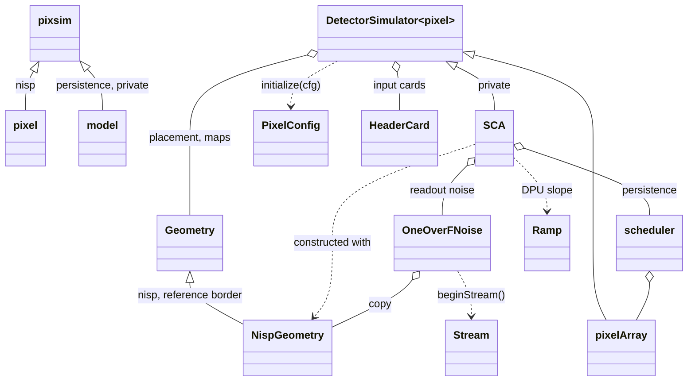
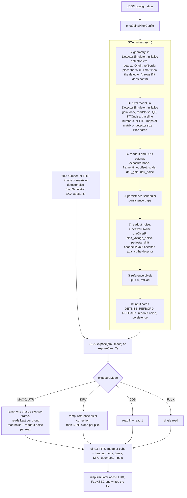
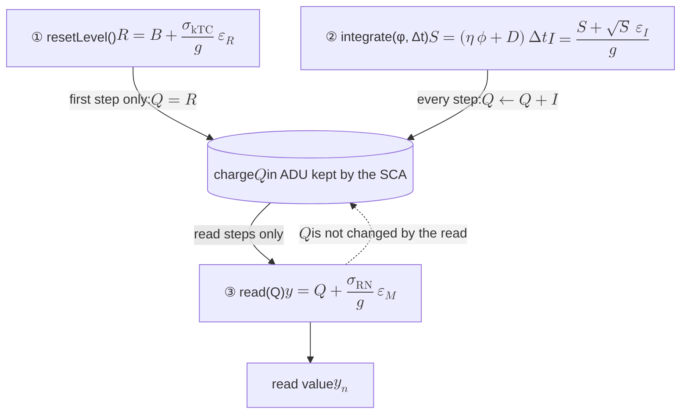

# NISP example: the Euclid HAWAII-2RG detectors

`src/nisp/` is a complete instrument built on the phot2pix core: a simulator of the infrared detectors of Euclid's **NISP** (Near-Infrared Spectrometer and Photometer). It shows how an instrument is assembled from the generic building blocks described in [Philosophy](Philosophy).

---

## 1. The instrument in a few lines

- NISP has 16 **Teledyne HAWAII-2RG** (H2RG) HgCdTe arrays. Each SCA (sensor chip assembly) is 2048 × 2048 pixels of 18 µm, including a 4-pixel border of reference pixels (2040 × 2040 sensitive). Reference pixels have no photodiode but are read like the others, so they record the drifts of the readout electronics.
- An SCA is read **non-destructively**, one full frame every **1.45408 s**, through **32 output channels** of 64 columns each, read in parallel. One channel reads 2048 × 64 pixels per frame, one pixel every 11.1 µs.
- Reads are taken in **MACC(ng, nr, nd)** mode: *ng* groups of *nr* consecutive reads, separated by *nd* frames that are read but dropped.
  - Photometry uses MACC(4,16,4) (87.2 s between the first and last group).
  - Spectroscopy uses MACC(15,16,11) (549.6 s).
- The onboard **DPU** averages each group and fits a slope to the group averages (Kubik et al. 2016, PASP 128, 104504). Only that slope image is sent to the ground.

---

## 2. Architecture

### 2.1 Map of the code

| File | Content |
|---|---|
| `../phot2pix/PixelConfig.h` | `phot2pix::PixelConfig`: the typed key/value configuration, read from JSON. `HeaderCard` and `PixelConfig::card(key)`: an input written as a FITS header card |
| `../phot2pix/Geometry.h` | `phot2pix::Geometry`: the physical detector, the placement of the simulated matrix on it, and the mapping of detector-sized images onto the matrix |
| `../phot2pix/PixelSimulator.h/.cxx` | `phot2pix::pixsim`: the three stages of a pixel (reset, integration, read) |
| `../phot2pix/DetectorSimulator.h` | `phot2pix::DetectorSimulator<PixelT>`: the pixel array, its geometry, per-pixel FITS maps, threaded simulation, and the input header cards |
| `nispPixel.h/.cxx` | `nisp::pixel`: the H2RG pixel. `nisp::Ramp`: the DPU slope estimator (group co-adding, Kubik slope, Fowler, CDS) |
| `nispSCA.h/.cxx` | `nisp::SCA`: the detector, its readout modes, the reference pixel correction and its output header. `nisp::macc`: MACC parameters. `nisp::persistence`: the persistence model (`model`, `pixelArray`, `scheduler`) |
| `nispGeometry.h` | `nisp::Geometry`: the H2RG layout (2048 × 2048, reference border), derived from `phot2pix::Geometry` |
| `nispOneOverFNoise.h/.cxx` | `nisp::OneOverFNoise`: readout noise of the output channels (1/f noise per channel, bias voltage noise common to all channels, pedestal drift) and its continuous `Stream` over a ramp |
| `../utilities/nispSimulator.cxx` | Command-line tool driven by a JSON file |
| `../utilities/*.json` | A default configuration with averaged NISP values, and one test configuration per readout mode |

### 2.2 Classes



`NispGeometry` stands for `nisp::Geometry`.

How the layers map onto the [philosophy](Philosophy):

- **Pixel:** `nisp::pixel` uses the three `pixsim` stages unchanged (reset level, integration, read). NISP-specific pixel physics would go there, by overriding a stage.
- **Detector:** `nisp::SCA` inherits `DetectorSimulator<nisp::pixel>` **privately** and gives it a `nisp::Geometry`. Its simulation engines produce **charge only** (`resetLevel() + integrate()`), never a complete read. The geometry, the per-pixel maps and the cards that describe them come from the base class.
- **Instrument:** `nisp::SCA` marks the reference pixels, sequences the reads of each readout mode, adds the read noise (through `pixel::read()`) and the readout noise of the output channels at each read, runs the DPU processing (reference pixel correction, then slope) and writes the output header. Its only public simulation entry point is `expose()`; the reference pixel correction is also public, as two static functions ([§5](#reference-pixel-correction-of-a-ramp)).

### 2.3 The pipeline



1. **Configuration.** Every parameter lives in one `PixelConfig`, normally read from a JSON file ([§4](#4-configuration-reference)). The library reads all the detector keys; `nispSimulator` reads only the matrix size, the flux and the readout pattern.
2. **Initialisation** (`SCA::initialize`, in the order of the diagram). The base class configures the geometry first, so that the FITS maps are cropped at the right place, then applies the pixel model. The SCA then reads its own settings, creates the persistence scheduler, configures the readout noise (and fails if the channel layout does not fit the detector), sets the reference pixels, and records every input as a header card.
3. **Exposure** (`SCA::expose`). The charge of every pixel is simulated step by step and read according to `exposureMode` ([§3.3](#33-the-algorithm), [§5](#5-readout-modes)).
4. **Output.** A `uint16` image or cube, whose header holds the readout description and every input of the model ([§6](#6-output-header)).

---

## 3. The model in equations

This section writes down what the code computes. Every ε is an independent draw from a standard normal N(0, 1): draws are independent between pixels, between stages and between reads.

### 3.1 One pixel

| Symbol | Meaning | Unit | Config key |
|---|---|---|---|
| $`\phi`$ | Incident flux | ph s⁻¹ | input array |
| $`\eta`$ | Quantum efficiency | — | `QE` |
| $`D`$ | Dark current | e⁻ s⁻¹ | `dark` |
| $`g`$ | Gain | e⁻ ADU⁻¹ | `gain` |
| $`B`$ | Baseline | ADU | `baseline` |
| $`\sigma_{\mathrm{kTC}}`$ | Reset (kTC) noise | e⁻ | `KTCnoise` |
| $`\sigma_{\mathrm{RN}}`$ | Read noise | e⁻ | `readNoise` |
| $`t_f`$ | Frame time | s | `frame_time` |

**The three stages** (`phot2pix::pixsim`, used unchanged by `nisp::pixel`). Every stage returns ADU:

```math
\begin{aligned}
\text{reset:}\quad & R = B + \frac{\sigma_{\mathrm{kTC}}}{g}\,\varepsilon_R && \texttt{resetLevel()}\\[6pt]
\text{integration over } \Delta t\text{:}\quad & I(\Delta t) = \frac{S + \sqrt{S}\,\varepsilon_I}{g}, \qquad S = (\eta\,\phi + D)\,\Delta t && \texttt{integrate}(\phi, \Delta t)\\[6pt]
\text{read of a charge } Q\text{:}\quad & M(Q) = Q + \frac{\sigma_{\mathrm{RN}}}{g}\,\varepsilon_M && \texttt{read}(Q)
\end{aligned}
```

*S* is the mean number of electrons collected. Its shot noise √S is the Gaussian approximation of Poisson, and I(Δt) = 0 when S = 0.

**A single read** (`pixelresponse()`, the FLUX mode) chains the three stages:

```math
y = M\big(R + I(T)\big) = B + \frac{S + \sqrt{S}\,\varepsilon_I + \sigma_{\mathrm{kTC}}\,\varepsilon_R + \sigma_{\mathrm{RN}}\,\varepsilon_M}{g},
\qquad
\langle y\rangle = B + \frac{S}{g},
\qquad
\mathrm{Var}(y) = \frac{S + \sigma_{\mathrm{kTC}}^2 + \sigma_{\mathrm{RN}}^2}{g^2}
```

**A ramp** reads the pixel once per frame without resetting it. With $`S_f = (\eta\,\phi + D)\,t_f`$ the mean charge collected in one frame, the charge after frame *n* and the value of read *n* are

```math
Q_1 = R + I_1, \qquad Q_n = Q_{n-1} + I_n, \qquad y_n = M(Q_n) = Q_n + \frac{\sigma_{\mathrm{RN}}}{g}\,\varepsilon_n
```

where each $`I_n`$ is an independent draw of $`I(t_f)`$. The charge carries the memory of the ramp and the read noise does not. The statistics of the ramp follow:

```math
\langle y_n\rangle = B + n\,\frac{S_f}{g},
\qquad
\mathrm{Cov}(y_m, y_n) = \frac{\sigma_{\mathrm{kTC}}^2 + \min(m,n)\,S_f + \delta_{mn}\,\sigma_{\mathrm{RN}}^2}{g^2}
```

so that

```math
\mathrm{Var}(y_n) = \frac{\sigma_{\mathrm{kTC}}^2 + n\,S_f + \sigma_{\mathrm{RN}}^2}{g^2},
\qquad
\mathrm{Var}(y_{n+1} - y_n) = \frac{S_f + 2\,\sigma_{\mathrm{RN}}^2}{g^2},
\qquad
\mathrm{Var}(y_N - y_1) = \frac{(N-1)\,S_f + 2\,\sigma_{\mathrm{RN}}^2}{g^2}
```

The last relation is the CDS: the reset level *R* and its kTC noise cancel. These relations are the ones checked by `gTest_nispSCA.cxx` ([§9](#9-validation)).

### 3.2 The full array

Pixel *i* of the W × H matrix sits at column *x* and row *y*, with i = y·W + x. Every parameter of §3.1 can be a per-pixel FITS map: $`\eta_i, D_i, g_i, B_i, \sigma_{\mathrm{kTC},i}, \sigma_{\mathrm{RN},i}`$. Pixels remain independent, except through two terms that the SCA adds on top of the pixel model:

- the **readout noise** $`\mathcal{R}`$, in electrons, added at each read: the 1/f noise of each output channel, the bias voltage noise shared by all channels and the pedestal drift of each channel;
- the **persistence** *P*, which depends on the previous exposures and is added to the charge.

A quantiser then converts each value to `uint16`:

```math
\mathcal{Q}(x) = \min\big(65535,\ \max(0,\ \lfloor x + \tfrac{1}{2} \rfloor)\big),
\qquad
\mathcal{Q}_{so}(x) = \mathcal{Q}(s\,x + o)
```

with *s* = `scale` and *o* = `offset`.

#### Steps of a ramp

An exposure is simulated as a sequence of charge steps m = 1 … M of duration Δt_m. In MACC(n_g, n_r, n_d), each group contributes n_r steps of t_f, each followed by a read. Between two groups there is one step of n_d·t_f with no read (the dropped frames). Read *r* of group *g* is stored in layer ℓ = g·n_r + r and taken at frame

```math
n_\ell = g\,(n_r + n_d) + r + 1
```

that is, n_ℓ·t_f after the reset. UTR is MACC(N, 1, 0).

#### Charge

```math
Q_i[m] = R_i + \sum_{m'=1}^{m} \Big( I_i(\Delta t_{m'}) + P_i[m'] \Big)
```

$`R_i`$ is drawn at the first step only; the later steps are run with `baseline = "off"`.

#### MACC and UTR: one layer of the output cube

```math
Y_i[\ell] = \mathcal{Q}\Big( Q_i[m_\ell] + \frac{\sigma_{\mathrm{RN},i}}{g_i}\,\varepsilon_{i,\ell} + \frac{\mathcal{R}_i[n_\ell]}{g_i} \Big)
```

where $`m_\ell`$ is the step that ends at frame $`n_\ell`$. MACC and UTR layers are rounded and clamped but **not** scaled or offset.

#### Physical detector and placement of the matrix

The readout noise and the reference pixels are defined on the **physical detector** (`nisp::Geometry`), not on the simulated matrix: $`W_d \times H_d`$ = 2048 × 2048 pixels (`detectorSize`), a border of b = 4 reference pixels (`refBorder`), and channels of w = 64 columns (`colPerChannel`), channel *c* covering the physical columns [c·w, (c+1)·w). The W × H matrix is a part of that detector, placed at (x₀, y₀) (`detectorOrigin`, [0, 0] by default: the first matrix pixel is the first detector pixel):

```math
X_i = x_0 + x, \qquad Y_i = y_0 + y
```

Pixel *i* belongs to channel $`c(i) = \lfloor X_i / w \rfloor`$, and is a reference pixel when $`X_i`$ or $`Y_i`$ is within *b* of the detector edge. A 2048 × 2048 matrix is the full detector, a 2040 × 2040 one at [4, 4] its active area, a 2044-wide one at x₀ = 2 keeps 2 reference columns on each side, and a 256-wide one at x₀ = 896 covers the channels 14 to 17. At the default origin, a small matrix has the 4 reference columns on its left and the 4 reference rows at its bottom. A matrix that does not fit on the detector throws at `initialize()`. Since everything is derived from physical coordinates, a smaller matrix has the same channels, timing and noise spectrum as the corresponding part of the full detector: it is only cheaper.

The geometry also maps the per-pixel inputs onto the matrix (`phot2pix::Geometry`): a FITS map (`gain`, `dark`, `readNoise`, `QE`, `KTCnoise`, `baseline`) is either W × H, used as is, or $`W_d \times H_d`$, in which case the section [x₀, x₀ + W) × [y₀, y₀ + H) is used. Any other size throws at `initialize()`. A full-detector calibration map can therefore be used to simulate any part of the detector.

#### Readout noise

All channels are read in parallel, row by row, with no row or frame overhead. Within a frame, pixel *i* is read at pixel-clock sample $`t_i = Y_i\,w + (X_i - c(i)\,w)`$ of its channel, one frame being $`L = H_d\,w`$ samples (one sample every $`t_f / L`$ = 11.1 µs). The readout noise of pixel *i* in frame *n* is the sum of three components, in electrons:

```math
\mathcal{R}_i[n] =
\underbrace{\mathcal{N}_{c(i)}\big[(n - 1)\,L + t_i\big]}_{\texttt{oneOverF}}
+ \underbrace{\mathcal{C}\big[(n - 1)\,L + t_i\big]}_{\texttt{bias\_voltage\_noise}}
+ \underbrace{f\big(t_0 + t_{n,Y_i}\big) + \sigma_P\,\varepsilon_{c(i),n}}_{\texttt{pedestal\_drift}},
\qquad
t_{n,Y} = \Big(n - 1 + \frac{Y + \frac12}{H_d}\Big)\,t_f
```

$`t_{n,Y}`$ is the time since the reset at which physical row *Y* of frame *n* is read. Every component is off by default.

#### 1/f noise of channel *c*

The noise of channel *c* is a single time series over the whole ramp, a sum of n_p AR(1) processes:

```math
\mathcal{N}_c[t] = A \sum_{p=0}^{n_p-1} z_{c,p}[t],
\qquad
z_{c,p}[t] = \rho_p\, z_{c,p}[t-1] + \sigma_p\,\varepsilon_{c,p,t},
\qquad
z_{c,p}[0] \sim \mathcal{N}\Big(0,\ \frac{\sigma_p^2}{1 - \rho_p^2}\Big)
```

```math
\nu_p = \nu_{\min} \left(\frac{0.5}{\nu_{\min}}\right)^{p/(n_p-1)},
\quad
\nu_{\min} = \frac{1}{2 L},
\qquad
\rho_p = e^{-2\pi\nu_p},
\qquad
V_p = \frac{\sigma_p^2}{1 - \rho_p^2} \propto \nu_p^{\,1-a},
\quad
\sum_p V_p = 1
```

The corner frequencies ν_p are in cycles per pixel-clock sample and log-spaced (ν_0 = ν_min when n_p = 1). *A* is `amplitude` and *a* is `slope`. Each pole carries the variance $`V_p`$ that a spectrum ∝ 1/ν^a holds in its log step of frequency, so together the poles approximate that spectrum, with a stationary variance A². The processes start from their stationary state, since the amplifier does not reset with the pixels. The AR(1) processes of different channels are driven by independent draws, so channels are uncorrelated. [§4.7](#47-readout-noise) explains how to choose *A*, *a* and n_p.

Only the samples of the matrix are generated: the samples of the rows and columns outside it are skipped exactly, since an AR(1) process advances over *n* samples in one step,

```math
z[t + n] = \rho^n\, z[t] + \sigma \sqrt{\frac{1 - \rho^{2n}}{1 - \rho^2}}\;\varepsilon
```

so the cost scales with W × H.

#### Bias voltage noise

$`\mathcal{C}`$ is one series built like $`\mathcal{N}_c`$ (amplitude, slope and poles of `bias_voltage_noise`), but **shared by every channel**: it is indexed by the same pixel-clock sample $`t_i`$ in every channel. The pixels read at the same instant in all channels get the same value: this is the horizontal banding across the full width, repeating every 64 columns, that the left/right reference columns measure.

#### Pedestal drift

Each channel is offset by the same amount over all its pixels: a mean drift *f*, common to all channels and evaluated at the read time of each row, plus $`\sigma_P\,\varepsilon_{c,n}`$, one independent draw per channel and per frame (read or dropped). The top/bottom reference rows of a channel measure it.

```math
f(t) = \sum_k a_k\,t^k + \sum_j A_j\,e^{-t/\tau_j} + \sum_m B_m \sin\!\Big(\frac{2\pi t}{P_m} + \varphi_m\Big)
```

$`t_0`$ places the exposure in time (for example after a power-on or a mode change). A constant offset belongs to the `baseline` map instead: it is drawn at the reset and cancels in every difference, whereas the pedestal drift changes from one read to the next.

#### Persistence

Each past exposure *j* leaves a stored charge $`E_i^{(j)} = \eta_i\,\phi_i^{(j)}\,T^{(j)}`$, in electrons, where $`T^{(j)}`$ is the integration time registered for that exposure (see [§10](#10-known-limitations) for MACC). Trap *k* releases it at the rate $`E\,f_k\,e^{-t/\tau_k}`$, *t* being the time since the end of exposure *j*. The charge released during step *m*, which starts $`\Delta_j[m]`$ after the end of exposure *j* and lasts $`\Delta t_m`$, is the integral of that rate over the step:

```math
P_i[m] = \sum_j E_i^{(j)} \sum_k f_k\,\tau_k\, e^{-\Delta_j[m]/\tau_k} \left( 1 - e^{-\Delta t_m/\tau_k} \right),
\qquad
\Delta_j[m] = \sum_{m' < m} \Delta t_{m'} + n_j\,\delta
```

$`f_k`$ is therefore a release rate (s⁻¹) per stored electron, and $`f_k\,\tau_k`$ the fraction of the stored charge that trap *k* releases in total ([§4.8](#48-persistence)); consecutive steps add up to the release over their total duration. The elapsed time $`\Delta_j[m]`$ counts the simulated steps since exposure *j*, plus the delay δ = `dT` between two exposures, once for each of the $`n_j`$ exposures that have ended since *j* (exposure *j* included). $`P_i[m]`$ is added to the charge as it is, without conversion by $`g_i`$.

#### FLUX and CDS

Both modes read the array once or twice. Each read draws a new, independent readout-noise realisation whose AR(1) processes start from their stationary state ($`\mathcal{R}`$ and $`\mathcal{R}'`$ below). The pedestal drift is evaluated at the frame of the read: the last frame for FLUX, frames 1 and N for CDS.

```math
\text{FLUX:}\qquad Y_i = \mathcal{Q}_{so}\Big( M_i\big(R_i + I_i(T') + P_i[1]\big) + \frac{\mathcal{R}_i[N]}{g_i} \Big),
\qquad T' = \lfloor T/t_f \rfloor\, t_f = N\,t_f
```

```math
\text{CDS:}\qquad
\begin{aligned}
Q_i^{(1)} &= R_i + I_i(t_f) + P_i[1], \qquad
Q_i^{(N)} = Q_i^{(1)} + I_i\big((N-1)\,t_f\big) + P_i[2], \qquad N = \lfloor T/t_f \rfloor\\[4pt]
Y_i &= \mathcal{Q}_{so}\Big( \Big[M_i(Q_i^{(N)}) + \frac{\mathcal{R}'_i[N]}{g_i}\Big] - \Big[M_i(Q_i^{(1)}) + \frac{\mathcal{R}_i[1]}{g_i}\Big] \Big)
\end{aligned}
```

In CDS, the pedestal drift leaves $`f(t_0 + t_{N,Y}) - f(t_0 + t_{1,Y})`$.

$`M_i`$ is the read of §3.1 with the parameters of pixel *i*. Each call draws a new ε. The windowed single read `expose(flux, t, c0, r0, nc, nr)` uses the FLUX expression on the window, with *T* not rounded to whole frames.

#### Reference pixel correction

It works on a full 2048 × 2048 matrix (the whole detector), one read at a time. Write $`Y[\ell](x, y)`$ for read ℓ at column *x* and line *y*. For output channel ch, which covers the columns [64·ch, 64·ch + 64), and for a line y ∈ [4, 2044), the correction is Eq. 3 of Euclid Collaboration (arXiv:2507.11326), from Kubik et al. (2014):

```math
c_y^{(\mathrm{ch})}[\ell] = \tfrac12\big(T^{(\mathrm{ch})}[\ell] + B^{(\mathrm{ch})}[\ell]\big) + \tfrac12\big(L_y[\ell] + R_y[\ell]\big)
```

Each term is a median over reference pixels of the same read:

```math
\begin{aligned}
T^{(\mathrm{ch})}[\ell] &= \operatorname{med}\big\{\,Y[\ell](x, y') : x \in X_{\mathrm{ch}},\ 2044 \le y' < 2048\,\big\}, &
B^{(\mathrm{ch})}[\ell] &= \operatorname{med}\big\{\,Y[\ell](x, y') : x \in X_{\mathrm{ch}},\ 0 \le y' < 4\,\big\},\\
L_y[\ell] &= \operatorname{med}\big\{\,Y[\ell](x, y') : 0 \le x < 4,\ |y' - y| \le 4\,\big\}, &
R_y[\ell] &= \operatorname{med}\big\{\,Y[\ell](x, y') : 2044 \le x < 2048,\ |y' - y| \le 4\,\big\}
\end{aligned}
```

- **Columns $`X_{\mathrm{ch}}`$:** the columns of the channel without the left and right reference columns. That is [4, 64) for channel 0, [1984, 2044) for channel 31, and [64·ch, 64·ch + 64) for the others.
- **Pixels per median:** T and B use 4 × 64 pixels (4 × 60 for channels 0 and 31). L and R use 4 columns × 9 lines.
- **Corrected read:** $`Y[\ell](x, y) - c_y^{(\mathrm{ch})}[\ell]`$, applied to the 64 columns of the channel, including the left and right reference columns. The top and bottom reference lines are not corrected ($`c = 0`$).

The `mode` bitmask selects the terms. `TOP` or `BOTTOM` alone replace the first term by T or B, and `TOPnBOTTOM` keeps their mean. `LEFT`, `RIGHT` and `RIGHTnLEFT` do the same for the second term. `ALL` is Eq. 3.

#### DPU: the onboard slope, per pixel

The DPU starts from the MACC layers $`Y_i[\ell]`$. Let $`n_{\mathrm{good}}`$ be the number of groups before the first group that contains a saturated read (65535 in the raw reads $`Y_i[\ell]`$). The reads are corrected for the reference pixels (`ALL`, previous paragraph) in double precision. With y(i) and ch(i) the line and channel of pixel *i*:

```math
Y'_i[\ell] = Y_i[\ell] - c_{y(i)}^{(\mathrm{ch}(i))}[\ell]
```

On a matrix smaller than 2048 × 2048, $`Y'_i = Y_i`$. Then

```math
G_g = \frac{1}{n_r} \sum_{r=0}^{n_r-1} Y'_i[g\,n_r + r],
\qquad
d_g = G_{g+1} - G_g,
\qquad
g < n_{\mathrm{good}}
```

and the Kubik et al. (2016) estimator, with $`\sigma_{\mathrm{DPU}}`$ = `dpu_noise` and $`g_{\mathrm{DPU}}`$ = `dpu_gain`, is

```math
\alpha = \frac{1 - n_r^2}{3\,n_r\,(n_r + n_d)},
\qquad
\sigma = \frac{\sigma_{\mathrm{DPU}}}{g_{\mathrm{DPU}}},
\qquad
\beta = \frac{2\,\sigma^2}{g_{\mathrm{DPU}}\, n_r\,(1 + \alpha)},
\qquad
\gamma = \frac{2}{g_{\mathrm{DPU}}\,(1 + \alpha)}
```

```math
\bar F = \frac{1}{n_{\mathrm{good}} - 1} \sum_{g=0}^{n_{\mathrm{good}}-2} (d_g + \beta)^2,
\qquad
\hat F = \frac{\sqrt{1 + \gamma^2 \bar F} - 1}{\gamma} - \beta,
\qquad
Y_i =
\begin{cases}
\mathcal{Q}_{so}(\hat F) & n_{\mathrm{good}} \ge 2\\
65535 & \text{otherwise}
\end{cases}
```

$`\hat F`$ is in ADU per group interval, (n_r + n_d)·t_f. For an unsaturated pixel, $`\langle d_g \rangle = (n_r + n_d)\,S_{f,i}/g_i`$.

### 3.3 The algorithm

#### One pixel

The pixel provides three stages and holds no state. The charge *Q* is kept by the caller, the SCA readout loop, which decides when to reset, how long each step lasts and when to read.

<!-- Diagram labels use Mermaid's KaTeX syntax $$…$$ (Mermaid ≥ 10.9). -->



- **Single read (FLUX):** reset, one step of *T*, one read.
- **Ramp (MACC, UTR):** reset, then one step per frame, with a read after each frame that is not dropped. The n_d dropped frames are a single step of n_d·t_f.

#### Full array: one exposure

`nisp::SCA::expose()` dispatches on `exposureMode`. In the ramp loop, each step runs three tasks concurrently and then makes one threaded pass over memory.

```mermaid
flowchart TD
    START["expose(flux, macc) or expose(flux, T)"] --> MODE{"exposureMode"}

    MODE -->|"FLUX"| FL["one charge step over $$T'$$, + persistence<br/>one read: $$M_i(Q_i) + \mathcal{R}_i/g_i$$<br/>output $$\mathcal{Q}_{so}$$, $$W \times H$$"]
    MODE -->|"CDS"| CD["charge at read 1, then at read N, + persistence<br/>two independent reads, difference<br/>output $$\mathcal{Q}_{so}$$, $$W \times H$$"]
    MODE -->|"MACC, UTR, DPU"| INIT["$$\mathrm{cumul}_i = 0$$ in ADU<br/>open the readout-noise stream: AR(1) states per channel and for the bias voltage<br/>allocate the uint16 cube $$W \times H \times n_g n_r$$"]

    INIT --> STEP

    subgraph STEP ["Read step: frame n_ℓ, Δt = t_f"]
        direction TB
        subgraph PAR ["Concurrent tasks"]
            direction LR
            A1["readout noise<br/>stream.next(), one task per channel + one for the bias voltage<br/>$$\mathcal{R}_i[n_\ell]$$"]
            A2["pixel charge<br/>DetectorSimulator::simulate<br/>$$R_i\ (\text{first step only}) + I_i(t_f)$$<br/>pixel ranges split over threads"]
            A3["persistence scheduler<br/>$$P_i[m]$$ over the past exposures $$j$$<br/>other half of the threads"]
        end
        SUM["$$\mathrm{frame}_i = \mathrm{charge}_i + P_i[m]$$"]
        ACC["_accumulate, threaded<br/>$$\mathrm{cumul}_i \leftarrow \mathrm{cumul}_i + \mathrm{frame}_i$$<br/>$$Y_i[\ell] = \mathcal{Q}\big(M_i(\mathrm{cumul}_i) + \mathcal{R}_i/g_i\big)$$"]
        PAR --> SUM --> ACC
    end

    ACC --> LASTR{"last read<br/>of the group?"}
    LASTR -->|"no"| STEP
    LASTR -->|"yes"| LASTG{"last group?"}
    LASTG -->|"no"| DROP["dropped frames, if $$n_d \ge 1$$<br/>one charge step of $$n_d\,t_f$$, + persistence<br/>skip $$n_d$$ frames of the readout-noise stream<br/>$$\mathrm{cumul}_i \leftarrow \mathrm{cumul}_i + \mathrm{frame}_i$$, no layer written"]
    DROP --> STEP
    LASTG -->|"yes"| REG["store the charge map $$E_i = \eta_i\,\phi_i\,T$$<br/>in the persistence history"]

    REG --> DPUQ{"DPU?"}
    DPUQ -->|"no: MACC, UTR"| CUBE["uint16 cube<br/>$$W \times H \times n_g n_r$$"]
    DPUQ -->|"yes"| RPC["reference pixel correction, threaded<br/>$$c_y^{(\mathrm{ch})}[\ell]$$ of every read: medians of T, B, L, R<br/>the uint16 cube is not modified"]
    RPC --> DPU["per pixel, threaded<br/>cut at the first saturated group, on the raw reads: $$n_{\mathrm{good}}$$<br/>subtract the correction in double: $$Y' = Y - c$$<br/>co-add the groups $$G_g$$<br/>Kubik slope $$\hat F$$<br/>output $$\mathcal{Q}_{so}(\hat F)$$"]
    DPU --> MAP["uint16 slope map<br/>$$W \times H$$"]
```

Two invariants hold throughout the loop:

- `cumul` contains **charge only**: R_i, the integrated signal and dark, and the persistence. The read noise and the readout noise are added to the layer that is written and never fed back, so read noise does not accumulate along the ramp.
- Pixels are independent within a step, so the charge pass needs no synchronisation. The only coupling between pixels is the readout-noise stream, generated per channel (plus the bias voltage series shared by all channels). The only coupling in time, apart from `cumul`, is the persistence history.

---

## 4. Configuration reference

### 4.1 Conventions

- One JSON object, read into a `PixelConfig`. Keys are case-sensitive; numbers can be written as integers or reals.
- **Units:** charges and noises in **electrons** (e⁻), levels and offsets in **ADU**, times in **seconds**, flux in **photons s⁻¹ pixel⁻¹** (before QE), sizes and positions in **pixels**. Every noise given in electrons is converted to ADU with the gain of the pixel it is added to.
- A FITS image given as input (a per-pixel map, the flux) is either the size of the matrix, used as is, or the size of the detector, cropped at `detectorOrigin`.
- A key that is absent keeps its default. The objects of `bias_voltage_noise` and `pedestal_drift` reject unknown keys, so a typo throws instead of being ignored.
- Every input is copied into the output header ([§6](#6-output-header)).

### 4.2 Matrix, flux and readout pattern (`nispSimulator`)

These keys are read by the tool, not by the library; a program using `nisp::SCA` directly passes the same quantities to the constructor and to `expose()`.

| Key | Unit | Default | Meaning |
|---|---|---|---|
| `width`, `height` | pix | 2048, 2048 | Size W × H of the simulated matrix, placed on the physical detector by `detectorOrigin` ([§4.3](#43-physical-detector-and-reference-pixels)). Smaller matrices are faster and keep the physics of the part of the detector they cover |
| `flux` | ph s⁻¹ pix⁻¹ | 0 (dark exposure) | Photons reaching each pixel, before QE. A number: uniform flux. A FITS image, in the forms of a per-pixel map ([§4.4](#44-pixel-model)): `"flux": "sky.fits"` (primary HDU), `"flux": {"file": "sky.fits", "hdu": 2}` or `{"file": "sky.fits", "hdu": "DET22.ZOD"}` (HDU index, 1 = primary, or EXTNAME), or `"flux": "sky.fits", "flux.hdu": 2`. The image is either W × H or detector-sized (then cropped at `detectorOrigin`; `FLUXSEC` in the header gives the section) |
| `macc` | — | — | Readout pattern `[ng, nr, nd]` ([§4.5](#45-readout-modes-and-timing)), or the three keys `ng`, `nr`, `nd` (not both) |
| `exposureTime` | s | — | Duration instead of a pattern: a UTR ramp of ⌊T/t_f⌋ reads in MACC, UTR and DPU; the time between reset and read in CDS and FLUX. Wins over `macc` if both are given (with a warning) |
| `benchmark` | — | 0 | Run the exposure N times and print timing statistics |

### 4.3 Physical detector and reference pixels

| Key | Unit | Default | Meaning and use |
|---|---|---|---|
| `detectorSize` | `[pix, pix]` | `[2048, 2048]` | Width and height of the physical detector. Defines the reference border, the output channels (its width must be a multiple of `colPerChannel`), the frame length of the readout noise and the size of a detector-sized map. Change it only for a detector other than the H2RG |
| `detectorOrigin` | `[pix, pix]` | `[0, 0]` | Physical column and row (0-based) of matrix pixel (0, 0). At the default, a small matrix starts in the corner of the detector and keeps its 4 reference columns on the left and 4 reference rows at the bottom. `[4, 4]` with 2040 × 2040 is the active area; ((2048 − W)/2, (2048 − H)/2) centres any matrix. The matrix must fit on the detector, otherwise `initialize()` throws |
| `refBorder` | pix | 4 | Reference pixels on each side of the physical detector; 0 disables them. Every matrix pixel whose physical position is within the border gets QE = 0 |
| `refDark` | e⁻ s⁻¹ | value of `dark` | Dark current of the reference pixels. They have no photodiode, so their residual signal comes from the readout circuit; measure it on the border of dark ramps |

### 4.4 Pixel model

Each key is either a number, applied to every pixel, or a per-pixel FITS map, matrix-sized or detector-sized ([§4.1](#41-conventions)): `"dark": "dark.fits"` (primary HDU), `"dark": "dark.fits", "dark.hdu": 2` or `"DARK"` (index or EXTNAME), `"dark": {"file": "dark.fits", "hdu": "DARK"}`, or `"dark.file": "dark.fits"`.

| Key | Symbol | Unit | Default | NISP | Physical meaning | How it is used |
|---|---|---|---|---|---|---|
| `gain` | g | e⁻ ADU⁻¹ | 1 | 1.92 | Conversion gain of the whole chain (pixel, preamplifier, ADC): electrons per ADU | Divides every charge and every noise in electrons; > 0 |
| `dark` | D | e⁻ s⁻¹ | 0 | 0.01 | Thermally generated charge per second | Integrated with the signal, with its shot noise: S = (ηφ + D)Δt |
| `readNoise` | σ_RN | e⁻ RMS | 0 | 13 | White noise of one read (source follower, ADC) | Added independently at each read, never accumulated: a CDS carries √2·σ_RN |
| `QE` | η | 0 – 1 | 1 | 0.94 | Fraction of the incident photons converted to electrons | Multiplies the flux; the reference pixels get 0 |
| `KTCnoise` | σ_kTC | e⁻ RMS | 0 | 48 | Reset noise: random offset of the reset level | Drawn once per reset, shared by every read of the ramp, so it cancels in any difference of reads |
| `baseline` | B | ADU | 0 | 10 000 | Mean reset level (bias pedestal) of the pixel | Level of a read with no charge; constant over the ramp; ≥ 0. A constant offset per channel belongs here, as a map |

### 4.5 Readout modes and timing

| Key | Unit | Default | Meaning and use |
|---|---|---|---|
| `exposureMode` | — | `MACC` | `MACC`, `UTR`, `CDS`, `FLUX` or `DPU` (case-insensitive): what `expose()` computes ([§5](#5-readout-modes)) |
| `macc` | — | — | `[ng, nr, nd]`: *ng* groups (≥ 1) of *nr* reads (≥ 1), separated by *nd* dropped frames. One group interval is (nr + nd)·t_f; the first-to-last group span is (ng − 1)(nr + nd)·t_f (87.2 s for MACC(4,16,4)); reset to last read is (ng(nr + nd) − nd)·t_f (76 frames) |
| `frame_time` (or `fr_time`) | s | 1.45408 | Time to read the whole detector once, all channels in parallel. It is the time step between two reads (signal per frame S_f = (ηφ + D)·t_f) and the time base of the readout noise: one pixel-clock sample lasts t_f / (H_d · `colPerChannel`) = 11.1 µs |

### 4.6 Digitisation and DPU

| Key | Unit | Default | Meaning and use |
|---|---|---|---|
| `offset` (or `dpu_offset`) | ADU | 0 | Added before the `uint16` conversion: DN = value × `scale` + `offset`. Keeps negative values (noise on the CDS of a dark pixel) above 0. Applied in CDS, FLUX, DPU and windowed reads, not to MACC/UTR layers |
| `scale` (or `dpu_scale`) | — | 1 | Multiplies the value before the conversion. For DPU, NISP uses SFACTOR = ng − 1, so DN − OFFSET is the signal integrated over `INTTIME` |
| `dpu_gain` | e⁻ ADU⁻¹ | mean pixel `gain` | Gain the DPU slope estimator assumes (header `GAIN`). Set it to simulate a DPU calibrated differently from the detector |
| `dpu_noise` | e⁻ | mean pixel `readNoise` | Read noise per read the estimator assumes (header `RN`). It does not include the readout noise: when the readout noise is large, set it to the total noise of one read |
| `refPixCorr` | — | `ON` | Reference pixel correction of the DPU (Eq. 3, mode `ALL`, [§3.2](#reference-pixel-correction)): `true`/`false`, or `"ON"`/`"OFF"` (any case). Applied only on a full 2048 × 2048 matrix (header `REFCORR`) |

### 4.7 Readout noise

The three components are added at each read, to the reference pixels as to the active ones, and converted to ADU with the pixel gain. They are defined on the physical channels ([§3.2](#physical-detector-and-placement-of-the-matrix)), so they do not depend on the size of the matrix. All are off by default.

#### `oneOverF`: 1/f noise of each output channel

```json
"oneOverF": { "amplitude": 15.0, "slope": 1.0, "nChannels": 32, "colPerChannel": 64, "nPoles": 16 }
```

The 1/f (flicker) noise of the preamplifier of each channel. The channels are independent. A number, `"oneOverF": 15.0`, sets the amplitude only.

| Key | Unit | Default | Meaning and use |
|---|---|---|---|
| `amplitude` | e⁻ RMS | 0 (off) | Total RMS of the channel noise in one read, over the whole band: what one pixel sees, in electrons. Over a ramp, the noise is continuous in time |
| `slope` | — | 1 | Spectral index *a*, PSD ∝ 1/ν^a. It decides how the variance is spread between pixel-scale noise and slow drifts (table below). 1 is pink noise |
| `nChannels` | — | 0 | Number of output channels. 0 derives it, `detectorSize` width / `colPerChannel` (32); any other value must equal it. A consistency check, it does not change the layout |
| `colPerChannel` | pix | 64 | Columns read by one output amplifier. Must divide the detector width. It fixes the channel boundaries and the readout order for **all three** components, and the frame length L = H_d · `colPerChannel` samples |
| `nPoles` | — | 16 | Number of AR(1) processes that approximate the spectrum over its 5.1 decades. It does not change the total variance; fewer poles give a lumpier spectrum, 1 pole a single Lorentzian whatever the slope. About 3 per decade is enough: 16. The cost grows linearly with it (one random draw per pole and per pixel) |

The spectrum spans the pixel-clock frequencies from ν_min = 1/(2L) to 0.5 cycles per sample. With the NISP timing, each scale of the image corresponds to a frequency:

| ν (cycles / sample) | Frequency | Period | In the image |
|---|---|---|---|
| 0.5 | 45 kHz | 2 pixels | Pixel-to-pixel noise along a row |
| 1/64 | 1.4 kHz | 1 row (0.71 ms) | Bands one row tall, one channel wide |
| 1/6400 | 14 Hz | 100 rows (71 ms) | Broad bands |
| 1/(2L) | 0.34 Hz | 2 frames (2.9 s) | Level of the whole channel changing from read to read |

and `slope` sets the share of the variance in each scale (16 poles):

| `slope` | Pixel scale (< 1 row) | Bands (1 – 100 rows) | Slower (channel level) | Looks like |
|---|---|---|---|---|
| 0 | ≈ 98 % | ≈ 2 % | — | Extra white noise per pixel, no banding |
| 1 | ≈ 30 % | ≈ 40 % | ≈ 30 % | Pink noise: horizontal banding at all scales |
| 2 | — | ≈ 10 % | ≈ 90 % | Brownian: the level of each 64-column stripe changes between reads, little banding |

For visible horizontal banding, use `slope` 1 with an amplitude comparable to the read noise.

#### `bias_voltage_noise`: 1/f noise common to all channels

```json
"bias_voltage_noise": { "amplitude": 10.0, "slope": 1.0, "nPoles": 16 }
```

The noise of the bias voltages shared by every channel: **one** series, seen by all channels at the same pixel clock. In the image, full-width bands that repeat every 64 columns; the left and right reference columns measure them row by row. A number sets the amplitude only.

| Key | Unit | Default | Meaning and use |
|---|---|---|---|
| `amplitude` | e⁻ RMS | 0 (off) | Total RMS of the common series in one read |
| `slope` | — | 1 | Spectral index, as for `oneOverF` |
| `nPoles` | — | 16 | Number of AR(1) processes, as for `oneOverF` |

If the 1/f noise of a channel was measured as a whole, split it between the two components: `oneOverF.amplitude`² = total² − `bias_voltage_noise.amplitude`².

#### `pedestal_drift`: offset of each channel

```json
"pedestal_drift": {
    "sigma": 4.0,
    "t0":    0.0,
    "drift": {
        "poly": [0.0, 0.05],
        "exp":  [{"amplitude": 20.0, "tau": 30.0}],
        "sin":  [{"amplitude": 2.0, "period": 300.0, "phase": 0.0}]
    }
}
```

An offset shared by all the pixels of a channel, changing from read to read (preamplifier and ADC offsets drifting with temperature). The top and bottom reference rows measure it. A number, `"pedestal_drift": 4.0`, sets `sigma` only; every form replaces the whole previous pedestal configuration.

| Key | Unit | Default | Meaning and use |
|---|---|---|---|
| `sigma` | e⁻ RMS | 0 | Random part: one draw per channel and per frame (read or dropped), independent between channels. 64-column stripes whose level changes from read to read |
| `t0` | s | 0 | Time added to the time since the reset in f(t): places the exposure in a longer sequence (after a power-on, a mode change…) |
| `drift.poly` | e⁻, e⁻ s⁻¹, e⁻ s⁻² … | — | Coefficients [a₀, a₁, …] of Σ a_k t^k: a linear or polynomial drift |
| `drift.exp` | e⁻, s | — | Terms A·exp(−t/τ), `{"amplitude": A, "tau": τ}`: a thermal settling. One object or an array |
| `drift.sin` | e⁻, s, rad | — | Terms B·sin(2πt/P + φ), `{"amplitude": B, "period": P, "phase": φ}`: a periodic drift, e.g. thermal regulation. One object or an array |

The drift f(t) is the same for all channels and is evaluated at the read time of each row, t = `t0` + (n − 1 + (Y + ½)/H_d)·t_f. A drift within one frame therefore appears as a gradient along the columns. A constant f is pointless: it belongs to `baseline`.

### 4.8 Persistence

```json
"persistence": [{"f": 1e-6, "t": 80.0}, {"f": 5e-6, "t": 8.0}]
"persistence": {"traps": [{"f": 1e-6, "t": 80.0}], "dT": 0.0}
```

Charge trapped during an exposure and released during the following ones. After each exposure, the SCA stores the charge map E = η·φ·T (e⁻); every later step receives the charge released during that step by every trap species *k* ([§3.2](#persistence)).

| Key | Unit | Default | Meaning |
|---|---|---|---|
| `f` | s⁻¹ | — | Initial release rate of trap *k* per stored electron. f·τ is the fraction of the stored charge that the trap releases in total: f = 1e-6 s⁻¹ with τ = 80 s releases 8 × 10⁻⁵ of the charge |
| `t` | s | — | Decay time τ_k of the release |
| `dT` | s | 0 | Delay between the end of an exposure and the start of the next one (dithers, overheads). The SCA simulates exposures back to back; at the end of each exposure, every stored exposure ages by `dT`, so the charge released during the delay is lost, as on the detector. Must be ≥ 0 |

Keep the `PixelConfig` object alive as long as the `SCA` when it contains `persistence`: the persistence scheduler keeps a reference to it.

### 4.9 A complete example

The NISP averages of `src/utilities/nispSimulator_default.json` (Euclid Collaboration 2025, arXiv:2507.11326), with the readout noise set to visible levels:

```json
{
    "width": 2048, "height": 2048,
    "detectorOrigin": [0, 0],
    "flux": 10.0,

    "exposureMode": "DPU",
    "macc": [4, 16, 4],
    "frame_time": 1.45408,
    "offset": 1024.0,
    "scale": 3.0,

    "gain": 1.92, "dark": 0.01, "readNoise": 13.0,
    "QE": 0.94, "KTCnoise": 48.0, "baseline": 10000.0,
    "refBorder": 4,

    "oneOverF":           { "amplitude": 15.0, "slope": 1.0, "nChannels": 32, "colPerChannel": 64, "nPoles": 16 },
    "bias_voltage_noise": { "amplitude": 10.0, "slope": 1.0, "nPoles": 16 },
    "pedestal_drift":     { "sigma": 8.0, "t0": 0.0, "drift": { "poly": [0.0, 0.05] } }
}
```

- The full detector: 4 reference pixels on each side, QE 0, dark current from `dark`.
- MACC(4,16,4) ramp fitted by the DPU. The output is DN = slope × 3 + 1024, so (DN − 1024) is the signal integrated over 87.2 s: 10 ph/s × 0.94 × 87.2 s / 1.92 ≈ 427 ADU.
- Per read: 13 e⁻ read noise, then pink 1/f noise of 15 e⁻ per channel, 10 e⁻ of common bands, and channel offsets of 8 e⁻ RMS drifting by 0.05 e⁻/s.

---

## 5. Readout modes

### Entry points

```cpp
nisp::SCA sca(2048, 2048);
sca.initialize(phot2pix::PixelConfig("config.json"));
std::valarray<double> flux(10.0, sca.size());            // photons / s / pixel

auto out  = sca.expose(flux, nisp::macc{4, 16, 4});      // readout pattern given explicitly
auto out2 = sca.expose(flux, 100.0);                     // exposure time in seconds
auto win  = sca.expose(flux, 100.0, c0, r0, nc, nr);     // single read of a window
```

The mode set by `exposureMode` decides what `expose()` computes:

| Mode | `expose(flux, macc)` | `expose(flux, t)` | Output (`uint16`) |
|---|---|---|---|
| **MACC** | Full ramp, groups and drops | UTR ramp of ⌊t / t_frame⌋ reads | W × H × (ng·nr) cube of reads |
| **UTR** | Same as MACC | UTR ramp of ⌊t / t_frame⌋ reads | W × H × N cube of reads |
| **CDS** | Last read − first read over the MACC duration | Last − first over *t* | W × H |
| **FLUX** | One read after the MACC duration | One read after *t* | W × H |
| **DPU** | Ramp, then onboard slope fitting | Slope fitted on a UTR ramp | W × H slope map |

The MACC duration is (ng·(nr+nd) − nd)·t_frame, i.e. 76 frames for MACC(4,16,4).

### How a ramp is built (MACC, UTR, and the input of DPU)

```
frame : 1 ······ 16 │ 17 ·· 20 │ 21 ······ 36 │ 37 ·· 40 │ ··· │ 61 ······ 76
        group 0     │  drops   │ group 1      │  drops   │     │ group 3
read  : R  R ··· R  │  · · · · │ R  R ··· R   │  · · · · │     │ R  R ··· R     → 64 layers
```

1. One array `cumul` holds the **charge** of every pixel, in ADU.
2. For each frame that is read:
   - `cumul += resetLevel() + integrate()` on the first frame, `cumul += integrate()` afterwards;
   - then the layer is written as `uint16( pixel.read(cumul) + readout noise / gain )`.
3. For dropped frames: `cumul += integrate()` over nd frames; nothing is read or stored, but the readout-noise stream advances by nd frames.
4. Read noise and readout noise are added to the layer **only**, never to `cumul`. Every read has RN², and two consecutive reads differ by 2·RN², as on the real detector.

The output cube is allocated once at its final size. Each ramp step (accumulate, read, convert) is a single threaded pass over memory.

### CDS

Correlated double sampling, computed literally:

```
f0 = read( charge at read 1 )            charge = reset level + 1 frame of signal
f1 = read( charge at read N )            charge = charge at read 1 + (N−1) frames
CDS = f1 − f0
```

The reset level and kTC noise cancel. The read noise and readout noise of the **two** reads remain (variance 2·RN²), as does the change of the pedestal drift between them. The result goes through `offset`/`scale`, so negative values (noise on dark pixels) survive when an offset is set.

### FLUX

A single read after the whole exposure: reset level + integration over *t* + one read. This is the fastest mode and is useful for quick image simulations.

### DPU: the onboard slope

The MACC ramp is simulated first. When `refPixCorr` is on (the default), `SCA::getReferencePixelCorrection(ramp)` then computes the reference pixel correction $`c_y^{(\mathrm{ch})}`$ of every read, with mode `ALL` ([§3.2](#reference-pixel-correction)). On a matrix smaller than 2048 × 2048 there is no correction, and a warning is printed. The header keyword `REFCORR` records whether the correction was applied. Then, for each pixel (threaded, with no allocation per pixel):

1. **Saturation:** the reads are copied group by group, up to the first group that contains a saturated read (65535). Only the groups before it are used. With fewer than 2 good groups, the pixel is set to 65535.
2. **Reference pixel correction** (when on): while the reads are copied, the pixel's correction is subtracted in double. The `uint16` ramp itself is never modified, so nothing wraps around below 0, and the saturation test sees the raw reads.
3. **Co-adding:** each group is averaged (`Ramp::coadd`).
4. **Slope:** the Kubik et al. 2016 estimator (`Ramp::getSlope`) is applied, with σ = `dpu_noise` / `dpu_gain` (in ADU). It uses only the differences between groups, so the level left by the correction does not matter.
5. **Output:** `uint16(slope × scale + offset)`, the slope being in **ADU per group interval** ((nr+nd) frames).

To convert to a flux: flux [e⁻/s] = slope × gain / ((nr+nd)·t_frame) = slope × (ng − 1) × gain / `INTTIME`, with slope = (DN − `OFFSET`) / `SFACTOR`. With `scale` = ng − 1, DN − `OFFSET` is directly the signal integrated over `INTTIME`.

### Reference pixel correction of a ramp

The DPU's correction is also available on its own, as two static functions of `nisp::SCA`. Use them, for example, on a MACC or UTR ramp returned by `expose()`:

```cpp
auto ramp = sca.expose(flux, nisp::macc{4, 16, 4});        // exposureMode MACC: uint16 cube

nisp::SCA::referencePixelsCorrection(ramp);                 // Eq. 3 (ALL), in place

// Or only the correction, without changing the cube:
std::valarray<double> c = nisp::SCA::getReferencePixelCorrection(ramp, nisp::SCA::TOPnBOTTOM);
const size_t nReads = c.size() / (2048 * 32);
double c_yk = c[(y * 32 + ch) * nReads + k];                // line y, channel ch, read k
```

| Function | Result |
|---|---|
| `getReferencePixelCorrection(ramp, mode)` | $`c_y^{(\mathrm{ch})}`$ of every read *k*, in the units of the cube, at `c[(y * 32 + ch) * nReads + k]` (the reads of one line and channel are contiguous). Lines 0–3 and 2044–2047 hold 0. Empty when `mode` is `NONE` or the image is smaller than 2048 × 2048 |
| `referencePixelsCorrection(ramp, mode)` | Subtracts that correction from the cube, in place |

`mode` is a `nisp::SCA::refPixCorrection` bitmask, `ALL` by default ([§3.2](#reference-pixel-correction)):

| Mode | Correction |
|---|---|
| `NONE` | None |
| `TOP`, `BOTTOM`, `TOPnBOTTOM` | T, B or ½(T + B) of the channel |
| `LEFT`, `RIGHT`, `RIGHTnLEFT` | L_y, R_y or ½(L_y + R_y) of the line |
| `ALL` | ½(T + B) + ½(L_y + R_y), Eq. 3 |

A top/bottom mode combined with a left/right one adds the two terms. `|` gives an `int`, so cast the result: `static_cast<nisp::SCA::refPixCorrection>(nisp::SCA::TOP | nisp::SCA::LEFT)`.

What the in-place correction stores depends on the type of the cube:

- **Floating point and signed integer:** v − c. For integer types the result is rounded to the nearest value (not truncated) and clamped to the type's range.
- **Unsigned, for example the `uint16` MACC ramp:** on raw reads, v − c is negative (c ≈ 2 × `baseline` with `ALL`), and an unsigned type cannot hold it. The function stores v − (c_k − c_0) instead, where c_0 is the correction of the first read. The differences between reads, and so the slopes, are those of Eq. 3, and the level stays the raw one. A single-read unsigned image is therefore left unchanged. Reads at the type's largest value (65535 for `uint16`) are saturated and are left unchanged too.

Both functions accept 2D (one read) and 3D cubes of any integer or floating-point type, and run on all hardware threads.

---

## 6. Output header

Every comment starts with the unit in square brackets (FITS convention), e.g. `GAIN = 1.92 / [e-/ADU] Mean gain used by the DPU`.

**Readout and DPU**

| Keyword | Content |
|---|---|
| `MODE` | Readout mode |
| `NG`, `NR`, `ND` | MACC parameters (MACC, DPU) |
| `REFCORR` | `ON` when the DPU applied the reference pixel correction, `OFF` when `refPixCorr` is off or the matrix is smaller than 2048 × 2048 (DPU) |
| `INTTIME`, `EXPTIME` | Integration and exposure times, s. For DPU, `INTTIME` = (ng − 1)(nr + nd)·t_frame, the span from the first to the last group (87.2 s for MACC(4,16,4)) |
| `FRTIME` | Frame time, s |
| `GAIN`, `RN` | Gain (e⁻/ADU) and read noise (e⁻) used by the DPU |
| `OFFSET`, `SFACTOR` | DN = value × `SFACTOR` + `OFFSET` (ADU) |
| `PERSIST` | `ON` when persistence is modelled |
| `PHOT2PIX` | Library version |

**Simulation inputs** (written only for the components that are on)

| Keyword | Content |
|---|---|
| `PIXGAIN`, `PIXDARK`, `PIXRN`, `PIXQE`, `PIXKTC`, `PIXBASE` | Pixel model as given: the value (e⁻/ADU, e⁻/s, e⁻, –, e⁻, ADU), or the file name of the per-pixel map with its HDU, e.g. `'dark.fits[DARK]'`. Recorded by `DetectorSimulator`, so every simulator gets them |
| `DETSIZE`, `DETSEC` | Physical detector size, and the section of it covered by this image (`'[1:2048,1:2048]'`, 1-based) |
| `REFBORD`, `REFDARK` | Reference border (pix) and reference-pixel dark current (e⁻/s, when `refDark` is given) |
| `CHANWID` | Columns per output channel |
| `OOFAMP`, `OOFSLOPE`, `OOFPOLES` | `oneOverF` |
| `BIASAMP`, `BIASSLOP`, `BIASPOLE` | `bias_voltage_noise` |
| `PEDSIGMA`, `PEDT0`, `PEDPOLY`, `PEDEXPn`, `PEDSINn` | `pedestal_drift`: σ, t₀, then the drift terms (`'0, 0.05'`, `'A=20 tau=30'`, `'B=2 P=300 phi=0'`) |
| `PERDT`, `PERTRn` | Persistence: delay between two exposures (s) and traps, release rate (s⁻¹) and decay time (s) (`'f=1e-06 tau=80'`) |
| `FLUX`, `FLUXSEC` | Written by `nispSimulator`: input flux (ph/s/pixel, or file name) and the section of the detector it covers |

A file is recorded by its name only (a FITS string holds at most 68 characters). A simulator built on phot2pix adds its own inputs with `setInputCard()` and writes them with `writeInputCards()`; `PixelConfig::card(key)` gives the value or file name of any key.

---

## 7. Noise and detector effects

| Effect | Where | Model | Configured by |
|---|---|---|---|
| Shot noise (signal, dark) | `pixsim::integrate()` | Gaussian approximation of Poisson; accumulates | `QE`, `dark`, flux |
| Reset (kTC) noise, baseline | `pixsim::resetLevel()` | Drawn once per ramp, at the first frame | `KTCnoise`, `baseline` |
| Read noise | `pixsim::read()` | Independent at each read | `readNoise` |
| 1/f noise | `nisp::OneOverFNoise` | Per output channel, independent between channels, continuous in time over a ramp | `oneOverF` |
| Bias voltage noise | `nisp::OneOverFNoise` | 1/f series common to all channels, at the same pixel clock | `bias_voltage_noise` |
| Pedestal drift | `nisp::OneOverFNoise` | Offset per channel and per frame: drift equation + white noise | `pedestal_drift` |
| Reference pixels | `nisp::SCA`, `nisp::Geometry` | Physical border with QE = 0 | `refBorder`, `refDark` |
| Reference pixel correction | `nisp::SCA` | Eq. 3 of arXiv:2507.11326: medians of the top and bottom reference lines per channel, plus sliding medians of the left and right reference columns per line. Applied by the DPU, or on request to any cube | `mode` argument; the DPU uses `ALL`, switched by `refPixCorr` |
| Persistence | `nisp::persistence` | Charge released by traps filled during previous exposures | `persistence` |
| Digitisation | `nisp::SCA` | Rounding and clamping to `uint16`; `offset`/`scale` are applied in CDS, FLUX and DPU, not to MACC/UTR layers | `offset`, `scale` |

### Reference pixels and the readout noise they measure

The reference pixels are read through the same channels as the active pixels, so a reference-pixel correction can only remove the readout noise the two share:

- **`pedestal_drift`**: one offset per channel and per frame. The top and bottom reference rows of a channel measure it.
- **`bias_voltage_noise`**: the same 1/f series in every channel at the same pixel clock, so horizontal bands across the full width. The left and right reference columns measure it row by row.
- **`oneOverF`**: independent in each channel. Only its slow part is seen by the reference rows; the rest stays in the data, as on the real detector.

The reference pixel correction ([§3.2](#reference-pixel-correction)) uses exactly these two measurements. T and B of each channel remove the pedestal, and $`L_y`$ and $`R_y`$ remove the bias voltage noise line by line.

### Persistence

The `persistence::scheduler` stores the charge map of every exposure. During each later frame it computes the released signal from all of them, on half of the available threads, while the pixel charge is simulated on the other half, and adds it to the charge.

---

## 8. The `nispSimulator` tool

`src/utilities/nispSimulator.cxx` simulates one SCA from a JSON configuration (built when the DSTCore library is available; installed in `bin/`).

```bash
nispSimulator -o exposure.fits -d 1 my_config.json
```

| Option | Effect |
|---|---|
| `-o <file>` | Output FITS file. Without it, the simulation runs but nothing is written (a warning is printed) |
| `-d <level>` | 0: warnings only; 1: run summary (matrix and its origin, mode, flux); 2: parameters, flux statistics, timings; 3+: full configuration dump |

The tool reads `width`, `height`, `flux`, `macc` or `exposureTime`, and `benchmark` ([§4.2](#42-matrix-flux-and-readout-pattern-nispsimulator)), passes the whole configuration to `SCA::initialize()`, reads a flux image with `SCA::loadImage()` (the file and HDU, as for a per-pixel map) and maps it onto the matrix with `SCA::toMatrix()` (matrix-sized, or detector-sized cropped at `detectorOrigin`), and adds `FLUX` and `FLUXSEC` to the output header.

Ready-made configurations:

- `src/utilities/nispSimulator_default.json`: averaged NISP pixel values, readout noise present but set to 0.
- `src/utilities/testcases/`: one configuration per readout mode at 10 ph/s. `CDS`, `FLUX` and `MACC` have every detector effect off (gain 1, QE 1); `UTR` and `DPU` use the NISP pixel values with readout noise on.

---

## 9. Validation

`src/test/gTest_nispReadoutModes.cxx` checks every readout mode on the 2040 × 2040 active area (origin [4, 4], no reference pixel), with MACC(4,16,4), 10 ph/s, gain 1, QE 1, and every other effect off. Each frame then adds S = 10 × 1.45408 = 14.5408 ADU, with Poisson variance S. Means and variances are checked over the 4.2 million pixels within 5σ.

| Mode | Expected | Flux recovered from |
|---|---|---|
| MACC | Layer 16g+f = (20g+f+1)·S | (G₃ − G₀) / (3·20·t_frame) |
| UTR | Read k = (k+1)·S, 76 reads | Least-squares slope |
| CDS | 75·S = 1090.56 ADU | CDS / (75·t_frame) |
| FLUX | 76·S = 1105.10 ADU | Value / (76·t_frame) |
| DPU | ≈ 290.8 ADU per group, scatter ≈ 9.4 ADU | Value / (20·t_frame) |

`src/test/gTest_nispSCA.cxx` checks the noise budget and the detector:

- Every MACC read carries RN² and read-to-read differences carry 2·RN² (read noise does not accumulate).
- A CDS carries 2·RN² while the reset level and kTC noise cancel.
- 1/f noise produces column-correlated banding.
- The readout noise is converted to ADU with the pixel gain; the bias voltage noise is identical in every channel; a pedestal drift survives in CDS.
- The reference pixels follow the physical border (default origin in the corner, 2044-wide matrix, `refBorder` 0); a detector-sized map is cropped at the origin; a matrix larger than the detector is rejected.
- The output header records the inputs.
- Persistence raises the signal of the next exposure, by the charge released during its frame after the delay `dT`.

`src/test/gTest_persistence.cxx` checks the persistence model on its own: the release over a step, consecutive steps adding up to one step, a total release of f·τ, the scheduler clock and the delay between exposures.

`src/test/gTest_nispOneOverFNoise.cxx` checks the readout-noise components on their own: configuration parsing and errors, the placement of the matrix on the physical detector (partial channels line up with the physical ones), the spectral index set by `slope`, bias voltage noise shared by all channels (including the pixel-clock offset of a 2040-wide frame), one pedestal offset per channel and per frame with RMS σ, and the drift equation evaluated at the read time of each physical row, in windows and along a stream.

`src/test/gTest_detector.cxx` checks `phot2pix::Geometry` (placement, extraction of a matrix-sized or detector-sized map, derived geometries); `gTest_pixelconfig.cxx` checks `PixelConfig::card()` for every input form; `gTest_nispPixel.cxx` checks the pixel stages and the `Ramp` estimator.

---

## 10. Known limitations

- With MACC parameters, the UTR mode produces the same output as MACC, and the MACC output always writes `MODE = MACC`. The MACC `EXPTIME` counts the drops after the last group.
- The gain convention inside `Ramp::getSlope()` has only been validated at gain 1: at other gains the shot-noise term of the estimator uses g instead of 1/g, which biases the slope slightly low.
- The readout-noise model reads every channel in the same direction and has no row or frame overhead.
- Persistence:
  - the charge stored after a MACC ramp uses the last integration interval instead of the total exposure;
  - the released charge, in electrons, is added to the charge in ADU without division by the gain.
- Saturation is applied at `uint16` conversion only; there is no full-well model on the accumulated charge yet.
- Reference pixel correction:
  - it needs a full 2048 × 2048 matrix. A smaller one, such as the 2040 × 2040 active area used by `gTest_nispReadoutModes`, is not corrected, and a warning is printed;
  - in the DPU, `refPixCorr` only switches the correction on or off. The mode is always `ALL`;
  - no test covers the correction yet.

<!-- This page is generated from wiki/NISP-example.md in the phot2pix repository. Edit it there: changes made in the web interface are overwritten on the next push. -->
