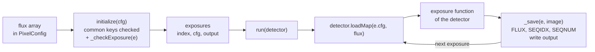
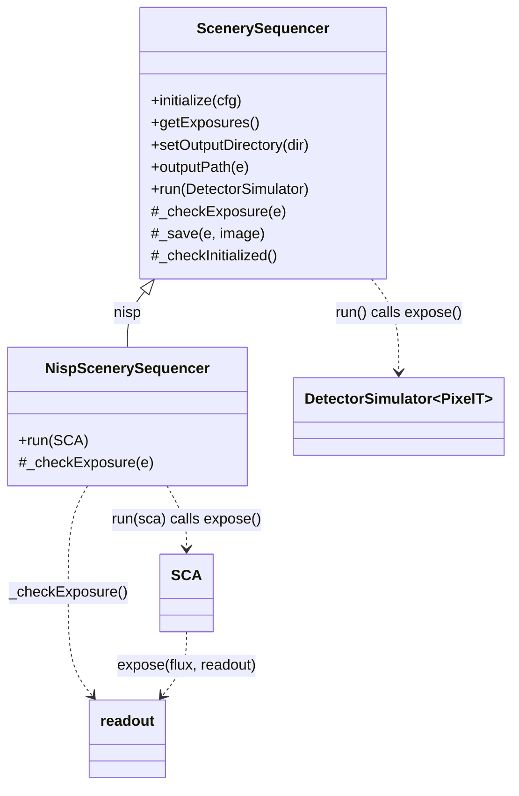

# ScenerySequencer: sequences of exposures

`phot2pix::ScenerySequencer` is the **Scene** layer of the [phot2pix](Philosophy#1-separate-what-changes-for-different-reasons) framework. It initiate a series of exposures on **one** detector, in time order. Because the same detector is used throughout, the effects that remember past exposures carry over from one exposure to the next: an exposure on a bright field leaves persistence in the darks that follow it.

Today, the scene of each exposure is static: a flux image (a FITS file) or a uniform flux. The generators that will build the sky, spectra, transients and moving objects are still to be written ([§7](#7-todo-scene-generators)).

The class is instrument-agnostic. A detector family inherits from it to add its own keys and to call its own exposure function. `nisp::ScenerySequencer` does this for the Euclid NISP detectors, and this page uses it as the reference example.

---

## 1. A sequence in the configuration

A sequence is a `"flux"` **array** in the JSON configuration, with one object per exposure, in time order:

```json
"flux": [
    {"file": "field.fits", "hdu": "DET13.SCI", "exposureTime": 100.0, "output": "exp1.fits"},
    {"flux": 0.0, "exposureTime": 500.0},
    {"flux": 0.0, "exposureTime": 500.0, "output": "dark.fits"}
]
```

The rest of the configuration (pixel model, geometry, readout noise, persistence…) describes the detector and is common to every exposure.

### Keys of an exposure (base class)

| Key | Unit | Default | Meaning |
|---|---|---|---|
| `file` | — | — | FITS image of the flux, before QE. It is either matrix-sized (used as is) or detector-sized (cropped at `detectorOrigin`), as for every per-pixel map |
| `hdu` | — | 1 | HDU of `file`: an index (1 = primary) or an EXTNAME |
| `flux` | ph s⁻¹ pix⁻¹ | — | Uniform flux on every pixel, **instead of** `file`. Must be ≥ 0, e.g. `0` for a dark. Exactly one of `file` or `flux` is given |
| `exposureTime` | s | — | Exposure time, > 0. Required by the base class. A detector family may accept another timing instead ([§3](#3-the-nisp-override)) |
| `output` | — | none | File the exposure is written to. Without it, the exposure is simulated but **not saved**: it still fills the history of the detector (persistence). Two exposures cannot have the same output |

Every other key of an entry is kept for the subclass to read (§2).

### What happens to each exposure

- **Checks before the run.** `initialize(cfg)` checks every entry before the first exposure is simulated, so a typo in the last entry does not cost a long simulation. An error names the entry, as in `ScenerySequencer: 'flux'[7]: …`, and the previous sequence is kept.
- **Order and memory.** Exposures are simulated in array order. Each one is written as soon as it is simulated and freed before the next, so only one image or ramp is in memory at a time.
- **Output directory.** `setOutputDirectory(dir)` puts each relative `output` in `dir`, which is created if missing. An absolute `output` is kept as is. `nispSimulator` uses its `-o` option as this directory ([§5](#5-nispsimulator-with-a-sequence)).
- **Header.** Every output carries the header of the detector, plus three cards:

| Card | Value |
|---|---|
| `FLUX` | The flux of the exposure: `file.fits[hdu]` (file name only), or the uniform value |
| `SEQIDX` | Number of the exposure in the sequence, from 1 |
| `SEQNUM` | Number of exposures in the sequence |

---

## 2. How the class works





`NispScenerySequencer` stands for `nisp::ScenerySequencer`.

### One exposure: `Exposure`

`initialize()` turns each entry into an `Exposure`:

```cpp
struct Exposure
{
    size_t      index;   // position in the "flux" array, from 0
    PixelConfig cfg;     // the entry's keys; "file"/"hdu" become "flux" = {"file", "hdu"}
    std::string output;  // the entry's "output"; empty → not saved
};
```

`e.cfg` is a `PixelConfig` holding the entry's own keys. Its `"flux"` is in the form `DetectorSimulator::loadMap()` reads: `{"file", "hdu"}` or a number. A run therefore loads the flux of an exposure with `detector.loadMap(e.cfg, "flux")`, and reads the keys of its own family from `e.cfg` with the usual accessors (`getAsDouble()`, `getJson()`, …).

### The extension points

| Member | Role | Base class |
|---|---|---|
| `virtual void initialize(const PixelConfig& cfg)` | Read the sequence. Override it to read keys of the whole sequence, calling the base first | Parses and checks the `flux` array |
| `virtual void _checkExposure(const Exposure& e) const` | Check the keys of **one** exposure that belong to your family. Throw any `std::exception` when the entry cannot be simulated; the base class adds the entry number to the message | Requires `exposureTime` |
| `run(YourDetector&) const` | The time loop: load the flux, call **your detector's** exposure function, save | `run(const DetectorSimulator<PixelT>&)` calls `expose(flux, exposureTime)`, which adds the cosmic-ray hits of the `"cosmic"` key ([CosmicDeposit §6](CosmicDeposit#6-using-it-from-a-detector-family)) |
| `_save(e, image)` | Add the sequence cards and write the output. Call it once per exposure | — |
| `_checkInitialized()` | Throw `std::logic_error` if `initialize()` was not called. Call it first in `run()` | — |

### Why `run()` is an overload and not a virtual function

- **`DetectorSimulator<PixelT>` is a template,** so the base `run()` has to be a member template, and a member template cannot be virtual.
- **Each detector family adds its own `run()`** for its own detector class. That overload hides the base one, so `nispSequencer.run(sca)` can only reach `nisp::SCA::expose()`.
- **The wrong call cannot happen silently.** `nisp::SCA` inherits `DetectorSimulator` privately, so an `SCA` cannot be passed to the base `run()`. Running it through `DetectorSimulator::expose()`, which skips the readout modes, persistence and the uint16 output, is a **compile error**, not a wrong result.

The sequencer does not hold the detector: it is passed to `run()`. You can therefore run several sequences one after another on the same detector, which keeps its persistence history.

---

## 3. The NISP override

`src/nisp/nispScenerySequencer.h/.cxx` is the complete example: about thirty lines. A NISP exposure gives its timing either as an exposure time or as MACC parameters, and may use its own readout mode.

### Keys of a NISP exposure

| Key | Unit | Default | Meaning |
|---|---|---|---|
| `exposureTime` | s | — | Duration of the exposure ([NISP example §4.2](NISP-example#42-matrix-flux-and-readout-pattern-nispsimulator)) |
| `macc` | — | — | Readout pattern `[ng, nr, nd]`, or the three keys `ng`, `nr`, `nd` (not both). Exactly one of `exposureTime` or MACC parameters is given |
| `exposureMode` | — | top-level `exposureMode` | `MACC`, `UTR`, `CDS`, `DPU` or `FLUX`, case-insensitive, for **this exposure only** ([NISP example §5](NISP-example#5-readout-modes)) |

### Step 1: parse the exposure in the instrument library

Following the rule *configuration is parsed in the library, not in the tools* ([Philosophy §4](Philosophy#4-configuration-driven)), the keys of one exposure are read by a single function of the NISP library, in `nispSCA.h`:

```cpp
struct readout
{
    std::optional<nisp::mode> exposureMode;        // empty → the SCA's mode
    std::optional<macc>       maccParams;          // "macc" or "ng", "nr", "nd"
    double                    exposureTime = 0.0;  // used when maccParams is empty

    // Exactly one timing, an optional "exposureMode"; throws std::invalid_argument otherwise.
    static readout fromConfig(const phot2pix::PixelConfig& cfg);
};
```

`readout::fromConfig()` reuses the parsers of the top-level keys:
- `modeFromString()`, which `SCA::initialize()` uses for `exposureMode`;
- `macc::fromConfig()`, which reads `macc`.

A key therefore means the same thing at the top level and in an exposure.

### Step 2: give the detector an exposure function that takes these parameters

`nisp::SCA` gets one more public `expose()` overload:

```cpp
std::shared_ptr<DSL::FITScube> SCA::expose(const std::valarray<double>& fullFlux, const nisp::readout& r);
```

It calls the existing `expose(flux, macc)` or `expose(flux, exposureTime)`, in the mode of `r` if it gives one. That mode is used **for this exposure only**: the SCA's own mode is restored afterwards, even if the exposure throws. The sequencer never changes the state of the detector behind your back.

### Step 3: the sequencer

```cpp
class ScenerySequencer : public phot2pix::ScenerySequencer
{
public:
    void run(SCA& sca) const;

protected:
    void _checkExposure(const Exposure& e) const override;
};

void ScenerySequencer::run(SCA& sca) const
{
    _checkInitialized();
    for (const Exposure& e : getExposures())
    {
        const std::valarray<double> flux = sca.loadMap(e.cfg, "flux");
        _save(e, *sca.expose(flux, readout::fromConfig(e.cfg)));
    }
}

void ScenerySequencer::_checkExposure(const Exposure& e) const
{
    (void) readout::fromConfig(e.cfg);   // the same parser as run(): check and run cannot disagree
}
```

How each part works:

- **`_checkExposure()` replaces the base check.** A NISP exposure may give `macc` instead of `exposureTime`. The common keys (`file`, `hdu`, `flux`, `output`, and `exposureTime` when present) are still checked by the base class.
- **`_checkExposure()` and `run()` call the same `readout::fromConfig()`.** An entry accepted at `initialize()` is one that `run()` can simulate.
- **`run()` loads the flux through the SCA.** `sca.loadMap()` applies the geometry of the SCA, which crops a detector-sized image at `detectorOrigin`.
- **`run()` calls the public `SCA::expose()`.** That entry point handles the readout modes, reference pixels, readout noise, persistence, DPU and output header.
- **Persistence carries over by itself.** `SCA::expose()` stores the charge of every exposure in the persistence scheduler, and the following exposures receive the released charge. The delay `dT` of the `persistence` key ([NISP example §4.8](NISP-example#48-persistence)) is applied between every pair of exposures.

### Using it

```cpp
phot2pix::PixelConfig cfg("sequence.json");   // keep it alive as long as the SCA (persistence)

nisp::SCA sca(2048, 2048);
sca.initialize(cfg);                           // the detector: common to every exposure

nisp::ScenerySequencer sequence;
sequence.initialize(cfg);                      // every exposure checked here
sequence.setOutputDirectory("results");
sequence.run(sca);                             // results/<output> for each exposure that has one
```

---

## 4. Building your own sequencer

To sequence another instrument, follow the same three steps.

1. **Parse the keys of one exposure in your instrument library.** Write one function that reads them from a `PixelConfig` and throws `std::invalid_argument` when they are wrong, like `nisp::readout::fromConfig()`.
2. **Give your detector a public exposure function** that takes these parameters. If your detector inherits `DetectorSimulator` privately, as `nisp::SCA` does, re-export `loadMap` with a `using` declaration.
3. **Derive from `phot2pix::ScenerySequencer`:**
   - override `_checkExposure()`, calling your parser;
   - add `run(YourDetector&) const`: call `_checkInitialized()`, then for each exposure load the flux, call your exposure function and `_save()`.

A sketch for a hypothetical camera whose exposure function is `expose(flux, exposureTime, nReads)`:

```cpp
namespace mycam
{
    // In the instrument library: the keys of one exposure.
    struct readout
    {
        double exposureTime;
        size_t nReads;

        static readout fromConfig(const phot2pix::PixelConfig& cfg)
        {
            const double t = cfg.getAsDouble("exposureTime");                       // checked > 0 by the base class
            const double n = cfg.has("nReads") ? cfg.getAsDouble("nReads") : 1.0;
            if (!(n >= 1.0) || n != std::floor(n))
                throw std::invalid_argument("\"nReads\" must be an integer >= 1.");
            return {t, static_cast<size_t>(n)};
        }
    };

    class ScenerySequencer : public phot2pix::ScenerySequencer
    {
    public:
        void run(Camera& camera) const
        {
            _checkInitialized();
            for (const Exposure& e : getExposures())
            {
                const std::valarray<double> flux = camera.loadMap(e.cfg, "flux");
                const readout r = readout::fromConfig(e.cfg);
                _save(e, *camera.expose(flux, r.exposureTime, r.nReads));
            }
        }

    protected:
        void _checkExposure(const Exposure& e) const override
        {
            phot2pix::ScenerySequencer::_checkExposure(e);   // keep "exposureTime" required
            (void) readout::fromConfig(e.cfg);
        }
    };
}
```

Guidelines:

- **Call the base `_checkExposure()`** when your family still requires `exposureTime`. Leave it out, as NISP does, when you accept another timing.
- **Keep the per-exposure state out of the detector**, or restore it after the exposure, as `SCA::expose(flux, readout)` does for the mode. The next exposure must start from the detector's own configuration.
- **Do not hold the detector in the sequencer.** Pass it to `run()`: the detector and its history belong to the caller.
- **Sequence-level keys**, for example a dither pattern or a repeat count, belong in an `initialize()` override that calls the base first.

### Example: a realistic NISP sequence

An Euclid-like observation: a spectroscopic exposure followed by the three photometric bandsrepeated 4 times before a slew dark.

```json
{
    "width": 2048, "height": 2048, "detectorOrigin": [0, 0],

    "exposureMode": "DPU",
    "frame_time": 1.45408, "offset": 1024.0, "scale": 3.0,
    "gain": 1.92, "dark": 0.01, "readNoise": 13.0, "QE": 0.94, "KTCnoise": 48.0, "baseline": 10000.0,

    "persistence": {"traps": [{"f": 2.0e-6, "t": 500.0}, {"f": 2.78e-8, "t": 18000.0}], "dT": 60.0},

    "flux": [
        {"file": "scene_spectro_d1.fits", "hdu": "DET13.SCI", "exposureMode": "DPU", "macc": [15, 16, 11], "output": "spectro_d1.fits"},
        {"flux": 1, "exposureMode": "MACC", "macc": [1, 1, 0]},  // exposure between two reset while detector is in IDLE to accumulate persistance signal while the wheel are moving
        ...
        {"flux": 1, "exposureMode": "MACC", "macc": [1, 1, 0]},// exposure between two reset while detector is in IDLE to accumulate persistance signal while the wheel are moving
        {"file": "scene_Y_d1.fits",       "hdu": "DET13.SCI", "exposureMode": "DPU", "macc": [4, 16, 4],   "output": "Y_d1.fits"},
        ...
        {"file": "scene_J_d1.fits",       "hdu": "DET13.SCI", "exposureMode": "DPU", "macc": [4, 16, 4],   "output": "J_d1.fits"},
        ...
        {"file": "scene_H_d1.fits",       "hdu": "DET13.SCI", "exposureMode": "DPU", "macc": [4, 16, 4],   "output": "H_d1.fits"},
        ...

        {"file": "scene_spectro_d2.fits", "hdu": "DET13.SCI", "exposureMode": "DPU", "macc": [15, 16, 11], "output": "spectro_d2.fits"},
        ...
        {"file": "scene_Y_d2.fits",       "hdu": "DET13.SCI", "exposureMode": "DPU", "macc": [4, 16, 4],   "output": "Y_d2.fits"},
        ...
        {"file": "scene_J_d2.fits",       "hdu": "DET13.SCI", "exposureMode": "DPU", "macc": [4, 16, 4],   "output": "J_d2.fits"},
        ...
        {"file": "scene_H_d2.fits",       "hdu": "DET13.SCI", "exposureMode": "DPU", "macc": [4, 16, 4],   "output": "H_d2.fits"},
        ...

        {"file": "scene_spectro_d1.fits", "hdu": "DET13.SCI", "exposureMode": "DPU", "macc": [15, 16, 11], "output": "spectro_d3.fits"},
        ...
        {"file": "scene_Y_d3.fits",       "hdu": "DET13.SCI", "exposureMode": "DPU", "macc": [4, 16, 4],   "output": "Y_d3.fits"},
        ...
        {"file": "scene_J_d3.fits",       "hdu": "DET13.SCI", "exposureMode": "DPU", "macc": [4, 16, 4],   "output": "J_d3.fits"},
        ...
        {"file": "scene_H_d3.fits",       "hdu": "DET13.SCI", "exposureMode": "DPU", "macc": [4, 16, 4],   "output": "H_d3.fits"},
        ...

        {"file": "scene_spectro_d1.fits", "hdu": "DET13.SCI", "exposureMode": "DPU", "macc": [15, 16, 11], "output": "spectro_d4.fits"},
        ...
        {"file": "scene_Y_d3.fits",       "hdu": "DET13.SCI", "exposureMode": "DPU", "macc": [4, 16, 4],   "output": "Y_d4.fits"},
        ...
        {"file": "scene_J_d3.fits",       "hdu": "DET13.SCI", "exposureMode": "DPU", "macc": [4, 16, 4],   "output": "J_d4.fits"},
        ...
        {"file": "scene_H_d3.fits",       "hdu": "DET13.SCI", "exposureMode": "DPU", "macc": [4, 16, 4],   "output": "H_d4.fits"},
        ...

        {"flux": 0.0, "exposureMode": "MACC", "macc": [4, 16, 4], "output": "slew_dark.fits"},
    ]
}
```

- **Detector.** The top-level keys describe the detector: averaged NISP values, two persistence traps (500 s and 5 h), and 60 s between exposures (slew, filter change).
- **Science exposures** are taken in the flight mode, `DPU` (the top-level `exposureMode`). The output is a cube of three planes: the slope image, as sent to the ground, its χ² and its error. The order of the bands is illustrative.
- **Slew dark** keep the full ramp (`MACC`), so the persistence released during each read can be seen.
- **Flux images** (`scene_*.fits`: the sky with its PSF, and the dispersed image for the spectroscopic exposure) are computed upstream until the generators of [§7](#7-todo-scene-generators) exist.
- While the NISP detector are IDLE (i.e. not exposing) the pixel are continuously reset every 1.45408 s. But pixels still collect photon and charge accumulated persistence signal. The `...` is the sery of `{"flux": 1, "exposureMode": "MACC", "macc": [1, 1, 0]}` exposure modeling the accumulation of persistence while the detector are IDLE. Such exposure design is needed if the persistence is activated and if the aim of the analyses is to the persistence. More realistic scenery exposure will rotate the field in front of the detector to mimic the effect of the nisp wheel rotation. Not the those exposur entry do not contins any output, so they are not saved, but they still fill the history of the detector.

---

## 5. `nispSimulator` with a sequence

When `"flux"` is an array, `nispSimulator` runs a `nisp::ScenerySequencer` instead of a single exposure:

```bash
nispSimulator -o results -d 1 src/utilities/testcases/nispSimulator_SEQUENCE.json
```

| Option or key | With a sequence |
|---|---|
| `-o <dir>` | Directory of the outputs: each `output` is written into it. Without `-o`, outputs are written to the current directory |
| `-d 1` | Lists every exposure (flux, mode, timing, output file or "not saved"), then the run time |
| top-level `exposureTime`, `macc` | Ignored, with a warning: each exposure gives its own timing |
| top-level `exposureMode` | The mode of the exposures that do not give one |
| `benchmark` | Ignored, with a warning |

The tool also warns when no exposure has an `output`. `src/utilities/testcases/nispSimulator_SEQUENCE.json` is a ready-made example: bright exposures, then a series of darks with persistence on.

---

## 6. Current limitations

- **Static scene.** The flux is constant during an exposure: there is no variable or moving source yet ([§7](#7-todo-scene-generators)).
- **One delay for every pair of exposures.** The time between two exposures is the persistence `dT`. There is no start time or delay per exposure.
- **No `FLUXSEC` card.** It is not written for the exposures of a sequence; the single-exposure tool writes it.
- **One file per saved exposure.** There is no multi-extension output of the whole sequence. A `DPU` exposure is written as its three-plane cube; the `SCI`, `CHI2` and `ERR2` HDUs are only written by `nispSimulator` for a single exposure.
- **No caching.** A flux file used by several exposures is read again for each of them.
- **Persistence limits** of the NISP model also apply to sequences: see [NISP example §10](NISP-example#10-known-limitations).

---

## 7. TODO: scene generators

The sequencer still needs generators that build the flux of each exposure, instead of reading it from a file. They will be owned by `phot2pix::ScenerySequencer`, configured in `initialize()`, and their flux added where `run()` loads `"flux"` today. They will work on the `Geometry` and the matrix size, so they are instrument-agnostic, and every detector family gets them through its `run()`.

- [ ] **`skyGenerator`**: the static sky.
  - [ ] stars: point sources through the PSF
  - [ ] galaxies: extended profiles convolved with the PSF
  - [ ] nebulae and other diffuse extended emission
  - [ ] sky background (zodiacal light, scattered light)
- [ ] **`spectrGenerator`**: the spectra of the sources, and the dispersed image of slitless spectroscopy (NISP grisms): the flux on each pixel from the spectrum of every source.
- [ ] **`transientGenerator`**: transient and variable sources (supernovae, variable stars) described by a light curve. Their flux changes during an exposure, so the affected window is re-simulated at a finer time step and composited into the full frame.
- [ ] **`movingObjectGenerator`**: moving objects (asteroids, satellites) following a trajectory. The window follows the object at each time step, which produces a trail.
- [ ] **Time window of each exposure**, needed by the transient and moving generators: its start time, its duration (from `exposureTime`, or `macc` × `frame_time` for NISP) and the delay before the next exposure. This also replaces the single persistence `dT` by a delay per exposure.
- [ ] **Windowed exposures in the sequence**, so that a transient or moving object costs in proportion to its area, not the area of the detector. `DetectorSimulator::expose()` and `SCA::expose()` already have windowed versions (`c0, r0, ncols, nrows`).

---

*The Phot2Pix logo has been generated by OpenAI's ChatGPT Image Generation tool (ImageGen).*

*This wiki page has been generated by AI (Claude Opus 5.5) by reading the code itself.*

<!-- This page is generated from wiki/ScenerySequencer.md in the phot2pix repository. Edit it there: changes made in the web interface are overwritten on the next push. -->
